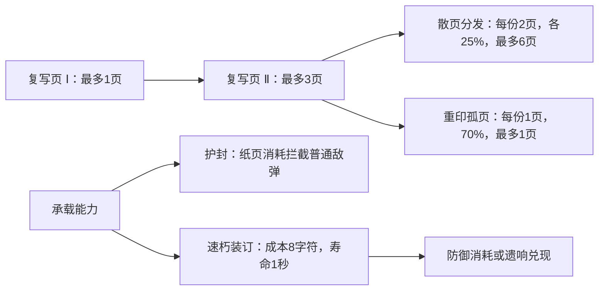

# 遗物能力图

遗物关联由能力描述，主书、副书、天赋和已经获得的遗物可以提供同一种能力。资格与候选关联只读取当前能力，不按法书组合或来源 ID 写配方。能力派生在 `src/shared/combat-capabilities.ts`，内容入口仍是 `src/content/manifest.ts`。

| 字段 | 含义 |
| --- | --- |
| `provides` | 获得后提供的能力；本身不构成前置要求 |
| `needs` | 当前必须已经拥有的全部能力 |
| `modifies` | 会改变或连接的能力，用于展示现有构筑关联 |
| `requires` | 必须已获得的遗物 |
| `requiresLevels` | 指定遗物的最低层级 |
| `excludes` | 互斥遗物；选择检查同时读取候选和已拥有遗物两侧声明 |

能力词汇为冰结构 `cold`、火载荷 `heat`、传导 `conduction`、承载 `carrier`、防御 `guard`、释放 `release`、回收 `recovery`。法书数据声明元素和能力；已获得遗物的 `provides` 与副书、天赋提供的额外能力去重合并。

## 复写结构

散页分发与重印孤页互斥，必须达到复写页Ⅱ阶后再消耗一次遗物选择。复写的基础成本为12个人工有效字符，35%主术伤害，释放等待1.8秒，寿命5秒。正常释放、防御消耗和到期是互斥出口；遗响由天赋提供。速朽装订保留1.8秒的正常等待时间，因此1秒寿命需要与防御或遗响共同使用。

冰晶书脊提供主术冰结构，余烬墨提供可积累的火载荷，导电缝线提供有限传导。余热匣回收人工主术尚未结算的灼烧并自动带入后续人工主术，派生产物不再次回收。具体结算和资源生命周期遵循 [战斗组合规则](COMBAT-RULES.md)。

## 候选与展示

先保留符合已有层级、法书、词长、能力和互斥条件的遗物，再从合格池按权重抽取最多三个不同选项。每次选中后移除该项，继续使用相同的玩法随机数发生器抽取，因此同内容、状态与随机种子可复现。

| 条件 | 权重增量 |
| --- | ---: |
| 基础 | 1.00 |
| 已拥有且未满层 | +0.35 |
| `needs` 或 `modifies` 与当前能力相交 | +0.35 |
| 法书 `affinity` 匹配 | +0.15 |
| `awaken` 稀有度 | +0.35 |

所有合格项都有正权重，保留探索空间。选择项用中文短词显示已有能力关联，权重不构成排序或毕业套装保证。图鉴和选择页通过同一 `RelicIcon` 与 `src/ui/relic-art.ts` 使用每件遗物的独立 SVG。

内容校验检查能力词汇、互斥引用、层级范围和依赖环。`node --test tests/relic-graph.test.cjs` 覆盖不同能力来源、结构资格、双向互斥、加权可复现和探索机会；`npm run validate:content` 使用现有生成流程更新内容 ID。
