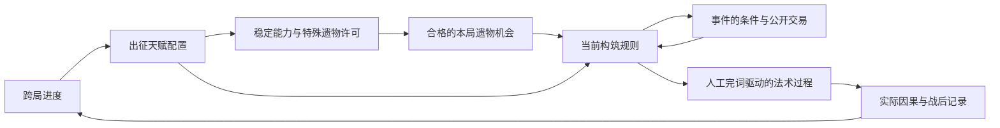

# 天赋—遗物—事件框架

> 历史归档：2026-10-08 调整范围前的设计、计划或证据。正文中的要求与“下一步”不构成当前任务；当前实施见[交接文档](../../../migration/AGENT-HANDOFF.md).

定位：有效的业务设计契约，承接[取舍](03-CONTENT-DECISIONS.md)，约束[候选内容](05-CONTENT-CATALOG.md)和[数据与算法](06-DATA-AND-ALGORITHMS.md)。其中部分规则已接入，完整框架尚未贯通，实际范围见[阶段总结](../STAGE-SUMMARY.md)。参数可校准，业务语义变更须同步相关文档。

## 1. 贯穿全系统的决定

| 决定 | 规则 |
| --- | --- |
| D01 | 打字始终是主要进攻来源；选目标决定力量首先作用于谁，闪避和弹反保护输入，强反击主要消耗打字积累的力量；法术内部处理自动进行 |
| D02 | 玩法关系、成长边、获取前置、演化关系、事件覆盖分开表示 |
| D03 | 性质说明对象能接受什么操作；书名不是通用反应条件 |
| D04 | 人工输入、资源来源、天赋许可属于不可伪造的事实，不能作为可任意赋予的标签 |
| D05 | 分配和转交不复制资源；新增威力与治疗等收益有明确预算来源 |
| D06 | 同一份资源只有一个所有者；防御、攻击、回收竞争尚未用掉的部分 |
| D07 | 复制可以继承形状和合法加工，不能复制人工回执、免费供给及已领取机会 |
| D08 | 关键节点以模式冲突和实际成本约束，取消全局两个上限 |
| D09 | 特殊遗物许可由本次出征实际分配的天赋生成；临时借能力不产生许可 |
| D10 | 事件报价冻结具体对象、效果、代价和期限，原子提交；离开也是一次已记录选择 |
| D11 | 成长图从语义与可达要求程序化生成，零交叉、仅近邻，不能静默删掉必需关系 |
| D12 | 本游戏图拓扑变更时保留已赚进度，失效配置允许重配；纯布局变化不退点，普通和 God 保存隔离 |

## 2. 三个层面的职责



这不是战斗调用链，也不表示天赋替玩家指定遗物。遗物机会始终保留深化、转向和可靠基础三种可能。事件看当前实际构筑，提供机会而非补齐命名套装。

## 3. 四种信息不能混成一套标签

| 信息 | 举例 | 谁能改变 | 如何使用 |
| --- | --- | --- | --- |
| 玩法概念 | 保存、聚合、热加工、词形 | 内容作者声明 | 自动布局、检索、设计覆盖；本身不触发伤害 |
| 对象性质 | 外壳易碎、耐热、导电；法术能飞行；尚有持续份额 | 正式操作改变，受对象类型约束 | 规则的条件与结果 |
| 数量与机会 | 威力、热量、电荷、制作额度、容量、一次拦截机会 | 资源事务支出或产生 | 决定实际可发生多少；一个文字标签不能代替数量 |
| 来源与权限 | 人工回执、敌弹回执、分配过的天赋、事件借阅期限 | 正式输入、配置和事件事务 | 防止自动供给、越权开池和重复领取 |

元素伤害组成与对象性质也不同：火焰伤害不自动等于有足够热量去打开外壳，冰性伤害不自动等于法术可碎裂，纸灵外观不自动意味着保存着可防御的法术。

Godot 使用中性、冰、火、雷、纸五类伤害组成。真实接触先消费原份额，再按目标当时的元素抗性计算伤害；抵抗损失不能回收，弱点放大不能生成资源。持续状态冻结组成，按各次作用读取抗性。敌人固定特征初始为 25% 抗性或弱点，普通敌人大多中性，无元素免疫；Boss 控制抗性与恢复间隔另算。R172 首次派发自动转换 25% 可转换伤害到严格更有收益的元素，随后冻结，改投、复制和再次保存均继承这次结果。

## 4. 对象与操作语义

### 4.1 对象

- **法术份额：**形状、伤害组成、剩余资源、目标策略、根来源及可继承操作。一次提交给目标的份额不再可分配。
- **外壳：**保存若干法术份额的物理对象，具有寿命、容量和可改变的性质。纸页、冰晶共享生命周期接口，视觉与默认参数可以不同。
- **持续效果：**已经登记但尚未结算的伤害或控制机会；按未来次数分账。抽取会实际减少后续效果。
- **有限区域：**固定落点、剩余储量和作用机会。敌人重复进入不免费补次数。
- **储备：**法书持有的合法剩余，保留类型和来源。第一批不允许玩家手动调度。
- **字符机会：**绑定词会话、位置、字母与回执，兑现或转移后旧机会失效。

### 4.2 操作

| 操作 | 输入与效果 | 必须支出的内容 |
| --- | --- | --- |
| Supply 供给 | 人工回执建立本次主术与制作收入 | 消费唯一有效回执；辅助字符不计收入 |
| Attach 附着 | 把已有材料交给法术、外壳或区域 | 原所有者对应余额 |
| Allocate 分配 | 分开或集中未结算份额 | 原份额；子份额总和不得超过原额与已声明增幅 |
| Store 保存 | 法术移交给外壳，等待合法出口 | 空间、制造工作量与延迟 |
| Transfer 转交 | 沿合法路径迁移所有权 | 距离、次数或电荷费用；不重复附着 |
| Heat 受热 | 改变外壳状态，满足阈值时请求开启或破裂 | 热量与被改变的结构；耐热模式先存热 |
| Fracture 破裂 | 消耗结构，把尚未使用的内容分配出去 | 外壳完整度与可用分裂次数 |
| Release 释放 | 领取未用法术并进入执行 | 单次出口权；命中时再支出伤害份额 |
| Copy 复制 | 按主术描述建立新份额 | 已赚制作额度；明确的复制效率与继承范围 |
| Merge 聚合 | 同次人工根的兼容份额并入一次处理 | 等待、容量；来源与已用记录不合并清零 |
| Recover 回收 | 收回未兑现且可回收部分 | 原剩余与回收机会；折损后才入卷 |
| Guard 防御 | 自动抵挡可拦截攻击 | 与攻击强度相称的未用威力、一次敌弹回执 |
| Convert 转换 | 改变一部分伤害组成或预留用途 | 原份额；固定转换阶段，同份额不能往返套利 |
| Mark 标记 | 转移或兑现字母机会 | 旧机会；输入者仍须完成真实位置 |
| Field 留场 | 把一部分作用留在地面 | 原份额、持续时间和有限作用次数 |
| Ongoing 持续时序 | 提前交付已有持续伤害，或付费延后尚未交付的部分 | 提前消费原份额与次数；延后消费命中主术的寒气及双方加工次数，不增加伤害 |

扩大威力、范围、时间与次数都计入收益预算。表内的资源约束并不是要求全系统所有收益恒等守恒：天赋增幅、遗物制作效率可以带来额外收益，但它们必须在编译与报告中有来源。

### 4.3 通用组合如何产生

热启检查“有可开启外壳、可消费热量、达到阈值”，不检查冰火书名。替换成装有雷术的纸页，仍可受热提前释放；给外壳耐热性质，则热量先积存。电性中继检查对象能转交和电荷是否足够，纸页、晶壳、有限区域都可能成为过路点。

规则允许复写后的法术继续分裂或传导，但不会再获得完词奖励。不同来源的两个相同操作许可去重；它们携带的独立数值修正按声明合并，不把相同许可误解为执行两遍。

## 5. 供给、顺序和有限性

### 5.1 一个输入引擎，多个使用方向

真实完词形成一次回执，记载人工输入的位置与数量。主术威力和辅助制作收入分别按书籍与当前合法增幅计算，二者都计入该书总预算。输入字符不是每个材料源都能独立兑现一次的无限代币。

基础防御在没有储备时仍可正常使用；基础反伤有很小的固定上限，强化反击的主要力量来自打字积累。敌方攻击身份用于确认真实接触和限制重复领取，不能仅凭“有合法敌弹来源”就持续供给足以代替打字的主要进攻。返咒能力把制作储备加入共享分配，强化反击消费其中的额度，后续附着从同份反击预算分出；具体参数见[修正方案](../migration/M3-REPAIR-PLAN.md)，仍需实际手感与统一收益验证。

完词事实另外保存尝试 ID、词会话版本、人工与辅助位置、错误数及完成类型。辅助补全消费已赚机会，只按真实手打前缀施法；辅助字母不增加收入、成长或完整人工完词的奖励与停用计数。取消不把人工投入带入下一次尝试；同前缀换目标和死亡续写保留当前尝试。散字使用已经转交的有限机会，并要求实际手打位置和词会话版本相符。

辅助补全通过 Ctrl 主动触发，不自动截断玩家正在输入的长词。意图记录当时的尝试、目标和输入进度，在下一固定步确认仍匹配后支付。机会不足或意图已经失效时不扣费、不结束另一词；菜单、暂停和文本编辑不提交战斗补全。

所有辅助材料源竞争同一个本词制作账户。内容声明默认份额和可用上限，编译器按固定权重分配，剩余额度按声明留存或损耗。加一本副书增加可用方向，不自动多出一整份收入。没有取得任何辅助入口时，不伪造额外法术来花光余额。

根节点提供对应书籍的基础性质入口；仅当前主书执行原生主术、施法节律和终式。走到另一法书起点可以取得其登记的材料入口，但不会启动第二套主术。T57 提供稳定副书选择，T58 关闭副书槽；异质遗物仍可用于独卷。

书根与合订的差别是取得入口的方式。走图到另一书根，取得该根的材料入口及附近成长机会；T57 则允许不走到该书根就指定一本非主书，接入它的基础材料。合订不视为购买了远方书根，不满足那里的指定天赋前置，也不授予其特殊遗物许可。选中的材料已经由书根或遗物提供时，入口仍只有一份；T57 另提供该种材料 10% 的同池加工保留改善，保证同类入口重叠时仍有实际增量。这是待校准幅度，不另增完整收入。

独卷关闭的是合订槽，不封锁已经购买的其他书根、通用天赋或异质遗物。它以固定主术形状换取专精收益，不能成为禁止跨区构筑的隐形书籍围墙。

### 5.2 固定阶段

一次事务顺序为：输入确认 → 收入与材料分配 → 装配与形状加工 → 发射或保存 → 命中准备 → 伤害及状态提交 → 已获后效 → 结束与回收。

同阶段数值修正先按明确的加法池、乘区与上限合并。相斥操作占用命名模式槽，例如外壳热处理、传导目标策略、保留防御方式。获取先后、内容数组顺序和对象 ID 不能决定谁抢走材料。ID 只用于同等目标的稳定选择和日志排序。

模式槽有一个未被占用时的基础行为；基础行为不是另一件冲突内容。常驻来源声明同一取值时合并并叠加其合法参数，声明不同取值才冲突。例如旧页优先、新页优先、选择最接近来袭威力的护页，是三种防御顺序；不能根据最后拿到哪件遗物悄悄切换。事件的临时改写走显式覆盖并在到期恢复。

事件可以在已定义模式槽上临时覆盖；被覆盖基础规则保留，事件到期后恢复。事件无法插入任意阶段代码。两件常驻内容争用同一模式且未声明兼容方式时，组合不合法，取得前就给出原因。

### 5.3 一次致死命中

命中准备记录这次确实具有的结构、材料与未付后效；提交真实伤害和持续效果后立即判定死亡。死亡不会清掉已登记的破裂或转交机会，也不让尸体继续承受伤害。

同一人工根下的即时后效结算到事务边界，再发布清房。未来定时攻击在清房时按明确回收或损耗处理，不越房追击旧目标。正常主术失去目标时，可保留至多一份待用主术供下一次合法人工施法接续；满位不叠加新槽，其他份额按当前回收规则处理。

### 5.4 停笔后的行为

已付法术可以完成有限过程，不能继续创造人工回执和制作收入。每个循环必须消费有限工作量、有限次数或终结某个对象；固定点资源低于最小单位时结束。复制与转换增幅对同一来源份额只能领取一次。

安全上限用于报告规则错误，不用于暗中砍掉正常构筑的后半段。编译器拒绝无法证明收束的规则组；运行时超出其已声明上界应记录错误与对应构筑，不能把截断结果当成平衡通过。

## 6. 天赋配置与成长

### 6.1 购买与生效分开

购买要求：与已分配网络接通、满足点数和明确的天赋前置、没有模式互斥。能力使用条件则在战斗中检查，例如热启还需要真的产生外壳和热量。不能依赖本局尚未获得的随机遗物，才能在主菜单完成合法购买。

初始主书起点免费，其他起点 2 点；普通刻度 1 点，机制入口 2 点，关键改写 4 点。取消全局关键节点数量上限，保留各模式槽冲突。撤点以整个已分配集合重新求合法连通闭包，完整预览连带退点。

拟采用 60 点普通上限，作为路径设计的候选标尺，整体平衡在 M5 完成后的 M6 进行。新游戏从零累计字符和初始 2 点开始，候选公式为：

```text
N <= 2640:             P = 2 + floor(N / 120)
2640 < N <= 7440:      P = 24 + floor((N - 2640) / 240)
N > 7440:             P = min(60, 44 + floor((N - 7440) / 480))
```

N 是本游戏去重后的累计有效人工字符，不是本局临时计数；15120 字达到候选上限。不迁入浏览器已有进度。曲线是待校准参数，不承诺对应固定游玩小时数。

### 6.2 长路径与早期体验

每书起点用初始 2 点可得到至少一种立即可用的机制；不用先花四五点纯数字才第一次变化。跨到相邻书籍核心的新增路径成本以 8–14 点、跨到对侧以 14–22 点作为候选观察值，按合法购买顺序计算。M4 记录费用与沿途用途，M6 再统一校准，不把几何长度或候选费用当作平衡已经成立。

长路径沿途最多连续两个当前无直接用途的节点，且其后应解锁清楚的用途；“当前无用途”按主书、已分配天赋与最小基础战斗情境判断，不拿未来随机遗物假定补齐。全图内部至少有多处环路，不通过唯一中央收费枢纽连接四书。

这些是生成与审查约束，不是手写指定路线。未满足时回到内容或语义关系修正，不能自动复制便宜节点凑通路。

## 7. 遗物资格、关系与演化

### 7.1 许可与使用条件

D09 规定：出征时冻结实际分配的天赋 ID 与其授予的许可。普通奖励先检查永久于本局的许可，再检查基础生效条件、层数、互斥和资产前置。

许可统一标识为 `permit:talent:<天赋ID>`，例如 `permit:talent:T22`。内容卡中的“遗响／echo”等名称仅说明用途，不是另一个许可。特殊遗物列出的 T 或 K ID 表示必须取得该节点授予的许可；如果未来需要“任一／全部”多节点条件，必须在定义中明确，不从并列名称猜测。

普通遗物没有天赋专属许可，能够提供新的基础方向。部分特殊工具要求对应天赋或关键节点的许可；同类能力来自遗物或临时借阅不满足这项许可。图鉴可预览这些遗物和解锁条件，进入候选池不保证掉落。

事件暂时覆盖一个天赋的战斗模式，不撤销其出征分配记录及许可。能力需求依然另查：有许可但暂时没有可用对象的专用遗物，不作为普通即时奖励强塞给玩家。

已获得遗物不因临时供给到期而删除。它的条件性效果暂停，其他效果继续，详情说明缺失的具体条件。借来的遗物本身则依明确期限归还，不能混同永久取得的资产。

### 7.2 候选与演化

普通候选在合格集合中抽取，关联仅为适度权重。少量重复无实际增量的许可型遗物可排除；不能因为当前伤害收益偏低，就排除新方向的入口。

候选多样性按性质和操作分组，而非固定十二个族。三选一尽量包含不同作用，但在合法集合不足时宁可明确减少选项或提供补给，不绕过许可。

演化是原子替换：移除指定旧资产及其获取性长期效果，再施加新资产。两件都只登记一次消耗过的奖励机会；继承预算不意味着父效果继续全部保留。专用终式遗物仍可有明确主书限制。

## 8. 事件的权限与期限

| 可以改变 | 不可以暗中改变 |
| --- | --- |
| 一个已定义模式、参数或对象性质，限定房／章／局 | 永久天赋配置、图连接或已赚点数 |
| 明确的当前遗物实例，替换／抵押／借用 | 看不见的随机删除对象 |
| 本次路线预算与后续奖励债务 | 将同一奖励机会同时算成新资产和免费事件 |
| 公开的下一房敌人组织与有限推进压力 | 根据玩家天赋点偷偷改变敌人属性 |
| 临时能力和试炼后才生效的规则 | 为借到的能力伪造天赋许可 |

事件至少有两种不同的可行动方案，以及离开；其中至少一种不依赖特殊构筑。若事件专属方案都无意义，则不出现这项事件。可靠基础选项可以是补给、换取下一次奖励或一项具体普通资产，但它也占用事件路线的机会预算，不能成为无成本总占优的白送项。

房级范围是下一战斗房间，章级范围包含明确的章节结束边界；菜单与暂停不消耗战斗期限。报价展示到期时会失去什么，抵押物何时原样返还、是否暂停获取效果也在报价内确定。

已有法术使用创建时的规则快照完成本房有限过程；事件到期后不再按旧规则制造新对象。章界清房先处理旧对象和归档，再撤销到期覆盖、返还抵押物，最后编译下一章构筑。

## 9. 图谱与玩家理解

天赋图全屏展开，法书在约 0.4R 处，火左上、雷上、冰右上、纸下；同方向偏本书概念，间隙偏融合。先根据内容组织圆环、分支、菱形与弧线等局部图形，再程序安排整图和真实成长路线；不手填单点坐标，不给每组强塞相同数量的内容。具体数据和步骤见[M4 天赋图方案](../migration/M4-TALENT-GRAPH-PLAN.md)。远程协同在详情解释，不画跨屏线。

遗物图共用布局与视口基础。默认展示概念邻域与直接演化；获取前置和事件引用在固定详情里列出并可定位。它不是第二张需要玩家花点购买的树。

普通节点为小型水晶刻点；机制节点有独立符号与局部金丝；关键改写有更强的外形差异，并清楚表现互斥模式。统一遵循[金丝水晶](../ART-DIRECTION.md)。固定右侧开放详情说明效果、代价、当前条件和真实相邻路径，不重复出征副书设置或内部术语。

事件结果引用三张关系，但不把所有引用同时连线。玩家应能回答“这一点改变什么”“这件遗物现在为什么可见”“少了什么条件”，无需理解资源类名。

## 10. 数值与难度责任

沿用[统一收益模型](../COMBAT-BALANCE-DESIGN.md)的 U、BP、路径机会成本和真实生存轨迹；关键节点四点的初始预算为 12 BP，普通一次遗物奖励为 8 BP。机制本身不免于收益评估，互相作用也不要求压到零。

最后两档不能靠隐形账号惩罚、等级锁或不可躲伤害保证成长需求。拟采用公开、有限的阶段推进压力：后期危险目标若长期未处理会造成失守，玩家可通过输出、控场、优先目标与有限延缓争取时间；不能无限绕场拖到通关。它只存在于预先定义的遭遇，不随当前账号点数偷偷调整。

初始高手、成熟中等操作、差构筑同点数、好运与普通运气必须分组评估。整体数值与压力阈值在 M5 完成后的 M6 统一校准，不能以设计推演宣称“最强人类绝不可能通关”。M4 先建立真实天赋图，再结合配置和战斗观察构筑体验。具体评估与退出条件见[整合与验收](07-INTEGRATED-PLAN.md)。
