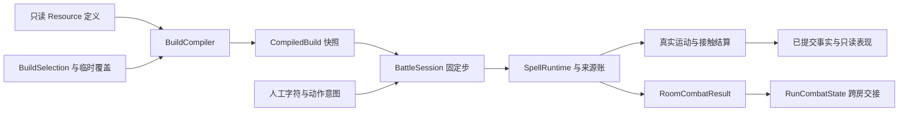

# M3 构筑与战斗规则接入

> 历史归档：2026-10-08 调整范围前的设计、计划或证据。正文中的要求与“下一步”不构成当前任务；当前实施见[交接文档](../../../migration/AGENT-HANDOFF.md).

本文件说明 Godot 构筑、有限资源、元素抗性和开发试验场的接口，供后续获取与远征直接接入。战斗使用同一编译器和执行链；正式购买、成长路径、奖励报价、事件期限与存档由 M4 持有。实际验证结果见[阶段总结](../STAGE-SUMMARY.md)，未完成工作见 TODO。

接口存在不代表每件内容已经完整生效。评审依据见天赋、战斗与打字核心评审，具体行为与验证顺序见[修正方案](M3-REPAIR-PLAN.md)。本文的事件交接表不构成完整交易流程已经就绪的证明。

## 原生入口与职责



| 文件或接口 | 实际职责 |
| --- | --- |
| `game/content/build/*.tres` | 4 个起点、60 个机制、20 个关键模式、122 个数值实例、171 件遗物；规则、参数、层数、许可和演化定义 |
| `game/build/build_compiler.gd` | `compile(BuildSelection)`；诊断 ID、类型、前置、模式、层数、永久许可与参数；无成长图购买证明 |
| `game/build/combat_rule_contract.gd` | 封闭的原生操作与参数单位；内容边界校验，运行时不解释表达式 |
| `game/session/battle_start_request.gd` | 构筑、词库、遭遇、难度、种子和词长策略 |
| `game/session/battle_session.gd` | `start(request, state)`、`queue_command(command)`、唯一固定步、运动与连续接触、胜败和一次房间结果 |
| `game/spells/spell_runtime.gd` | 收入分配、保存、持续、区域、路径、运输、词形、回收及其关闭事务 |
| `game/spells/resource_ledger.gd` | Q=1024 的整数来源账；准备费用与输出后共同提交，保留所有者、来源、领取历史和聚合谱系 |
| `game/combat/damage_packet.gd` | 中性及冰火雷纸组成；确定分摊、命中抗性与一次折光；伤害组成不能冒充材料 |
| `game/session/run_combat_state.gd` | 生命、护盾、共鸣、合法储备、停用词数、房间序号、资产使用回执；不保存旧房实体 |
| `game/build/combat_asset_service.gd` | `prepare(selection, request)` 返回新配置、编译诊断和待入队命令；不扣奖励货币或自行发布获取 |
| `game/build/combat_asset_instance.gd` | 逐份资产的稳定身份、来源、期限声明和演化记录；供获取及复起回执使用 |
| `ui/battle_rule_visuals.gd` | 已付外壳、有限区域、货物与已提交轨迹；不产生伤害 |

`CompiledBuild` 的 getter 返回副本，活动法术持有创建时的快照。改变构筑在下一固定步安装，新对象使用新规则，旧外壳、持续状态、货物与在途攻击沿原快照完成。本房不能换主书。能力入口去重，声明的数值增量累加；相同防御模式由多个来源提供时共用行为，不同模式显式冲突。

四个起点既可作为主书，也可在试验场作为其他材料入口选择。只有主书定义写入主术威力、节律和终式身份。合订的材料保留改善只作用于选定副书方向；独卷仍能接受合法的通用性质。

## 输入与结算契约

`WordCompletion` 记录尝试 ID、目标、词会话版本、人工位置、辅助位置、错字和完成类型。字符回执只能领取一次；相同前缀换目标保留尝试，取消丢弃未交付的人工投入。目标先死不会重发收入。已经由死亡事实转交到其他词咒位置的字母机会归新位置所有，原尝试结束不会把它再次领取或撤回。

Ctrl 提交主动补全意图，记录当时的尝试、目标和进度；下一固定步确认仍匹配后消费合法制作机会，只有人工前缀产生主术和制作收入。取消、换目标、换词或继续输入后，旧意图失效且不扣费。辅助后缀不记人工成长，不推进完整手打的施法计数、强化节律、雷书追加落雷或储备停用词数。散字必须匹配真实手打位置和词会话版本；换词后旧标记到期。

共同制作收入按固定方向顺序分配整数余数，复制、纸灵、治疗、材料与留存竞争同一账户。保存费用先准备；容量不足不扣制作费或领取保存机会。伤害份额拆分、转交、聚合与回收保留历史。余额上界为 `2^30`，中间乘积使用 64 位整数；分摊采用确定余数，不对子份额分别向上取整。

返咒、闪避牵引和闪避窗口等消费储备的能力会开放对应的制作分配，多个来源不重复开方向。基础反击最多 1 点；强化部分每次最多消耗 6 单位已赚制作额度，以基础兑换率 4 及合法效率增幅转为力量，再附着允许使用的回收储备。借势和下次主术附着从同份反击中分出，不按敌方伤害直接放大。

固定步消费输入和命令，提交装配与防御状态，推进世界时钟和到期作用，处理运动、真实接触、生命与死亡，最后判断波次和房间出口并发布状态。同目标已到时的持续作用先于新接触加工结清。守卫只选择尚未过期、仍持余额的合格对象。

外壳在关闭时先转移剩余所有权，再处理遗响、破裂或回收。普通保存页冻结分配计划而不提前发射分支；R168 只对尚未分配的保存份额延后判定。集束运输在拾取时聚合，再对整个货物计损耗，消费一次真实纸灵攻击。货物提前到达会等待原准备时间，返航不延长原寿命。

自动过程由实际支出、次数和寿命收束，没有全局八次加工截断。即时致死后效先提交；清房不等待没有目标的未来召唤队列。跨房只交接被允许归档的储备、来源历史和停用词数；账本拒绝失效房间引用。

## 元素与功能参数

参数版本为 `m3.2`。普通单房保持中性；`resistance_room.tres` 为现有敌人类型配置固定特征，每种只有一种抗性及一种弱点，幅度均为 25%，无元素免疫。敌人战斗定义与特征分别为 Resource，不依出生索引随机决定。词咒下显示特征文字和符号，命中读数标明抵抗或弱点。

命中消费原伤害份额后才计算实际伤害，抵抗损失不能回收，弱点放大不能铸成储备。持续状态冻结组成，各次作用读取当时抗性。积寒阈值为 100 cold；Boss 的控制递减和恢复间隔独立于元素抗性。R172 首次派发转换 25% 可转换伤害到严格更有收益的元素，随后冻结，复制、改投或再次保存不刷新权利。

八种独卷形状分别为贯冰、环晶、焰柱、余烬、束雷、辐雷、孤刃和巡刃。贯冰减少接触数、集中主目标份额；环晶在实际命中处展开剩余晶体；焰柱提高即时比例并留下较小的有限线形区域；余烬降低即时比例，把已有份额留在落点；束雷走真实直线接触；辐雷分配更多近处份额并缩短跳距；孤刃集中为一只纸灵，巡刃将原队列分得更细。形状不改变人工收入或主书身份。

T03 在基础及独卷形状之后增加一次穿透，并将主目标份额降为加工前的四分之三。R073 将复写允许保留的主术比例翻倍，最高为主术本身，且不超过已支付的兑换力量；每张复写页多占一格，普通保存页不受影响。与 R072 同用时先集中、再把同份输出分成两页。

这些数值是功能起值。目录所有 ID 的去向、Resource、入口、条件、费用、参数与验证族见生成的 M3 内容映射。`tools/content/import_m3_catalog.py` 从候选目录及明确的参数映射生成原生资源，运行时不读取 Markdown 或旧 TypeScript。更改候选映射后重生成，并审阅资源差异。逐项生命周期烟雾检查与机制情境回归分别记录，不能用定义登记或总通过数代替每条行为审查和 M6 收益评估。

## 原生构筑试验场

从仓库根运行：

```powershell
pwsh -File tools/godot/godot.ps1 run res://development/build_lab.tscn
```

选择主书、其他起点、天赋、遗物层数、副书、独卷形状与校准材料；检索 ID 或效果，选取后显示详情及编译诊断。它绕过成长图选取，仍检查前置、永久许可、层数和模式。

遭遇包括中性、密集、分散、耐久、弹幕、抗性、连续房间，以及“近敌与后排”“弱敌与要害”“连续三波”。后三种由 `BuildLabScenarios` 配置组成和初始位置，仍使用正式移动、预警、攻击和波次流程。战斗使用正式页面及键盘路由；Esc 暂停后先查看实际扣血、过量伤害、未用完的力量、挡伤、治疗和冻结触发，再查看来源与剩余。可调整构筑并在安全边界继续。连续房间持有同一个 `RunCombatState`，其他场景重新开始一局。开发配置只写 `user://development/build-lab.json`，不写普通或 God 成长数据。

`actual_damage_q` 表示实际扣血；`overkill_damage_q` 单列超出剩余生命的伤害，`unused_power_q` 记录结束或失去用途时未兑现的力量。按来源统计扣血和击破数。`RoomCombatResult` 保存独立副本；来源账的 `raw_spent_q` 仍包含制作、转换与清理，不能称为有效伤害。

## 事件和获取交接

`BuildSelection.instances` 保存正式逐份资产；`assets` 与 `asset_instances` 仅作开发层数及稳定 ID 适配，不能与正式实例混用。`CompiledBuild.assets()` 返回种类与层数，`asset_instances()` 返回逐份副本；一次性效果以 `usage_key()` 领取。每份实例声明来源、房／章／局期限及到期序号，期限推进由 M4 持有。

`CombatAssetRequest` 支持逐份新增、移除、演化、临时覆盖和恢复，编译完成才返回可安装命令。演化保留实例 ID 和期限，返还同一实例不刷新已记录的治疗、额外闪避充能与一次复起。同种不同实例在层数规则允许范围内共存，操作一份不会误删其他份。M4 将奖励报价、具体实例选择和付款事务与编译结果共同提交；不能先付款再忽略编译失败。

`CombatBuildOverride` 带独立 ID、来源和房／章／局期限，包含具名能力、停用能力、加法参数和登记模式。它不生成永久许可。覆盖可明确停用未来对象的能力，或清空一个登记模式槽；恢复移除指定覆盖并重编译原配置。多个覆盖争用不同模式时拒绝编译，不按数组次序选最后一个。旧对象继续持原快照。期限实际计数、试炼兑现与资产租约归 M4 控制器。

下表核对全部 32 个事件的战斗落点。正式出现池、报价与交易由 M4 的 `EventCatalog`、`EventTransactionService` 和 `RunSession` 接入，证据见[M4 验收记录](M4-ACCEPTANCE.md)。恢复交易消费 `RunCombatState.reserve` 中的真实余量；一次开场附加从该余量转移所有权。M4 持有报价 ID、实例、期限、未来奖励债务及挑战请求，M5 补完整遭遇；不可把未发生的恢复或尚未赚到的机会当成付款。

| 事件 | 战斗规则或模式接口 | M4 或 M5 持有的流程 |
| --- | --- | --- |
| E01 装订师的改页 | `guard-order` T23／T24；生命上限、保存空间参数 | 章末移除覆盖，只恢复上限 |
| E02 晶匠校形 | thin-shell／shell_durability、storage_lifetime／wait | 选定材质与章级借工具、奖励债务 |
| E03 孤弧定向 | chain-mode K08／K09，跳距与次数池 | 局级覆盖或房级借页，到期返还 |
| E04 借阅终章 | 临时 echo／heat-hold、空间与等待池 | 章／房租期；不授 T22 许可；奖励债务 |
| E05 借阅冰匣 | 保存空间、等待、merge 与空间交换 | 借阅期限和恢复交易 |
| E06 借阅旁路 | relay、chain-mode K08／heat-transfer、寿命池 | 一次借用机会回执；不同租期互斥 |
| E07 热缝接页 | shell-heat-mode K05／K04，热门槛与等待 | 临时寒气入口与奖励债务 |
| E08 同文接续 | inherit／base-copy、制作成本池 | 下一房分散挑战和奖励机会 |
| E09 余载入匣 | recovery、reserve_capacity、reserve-mode 与投入池 | 从真实储备支付恢复 |
| E10 炉心退火 | 选定资产替换；登记热模式和寿命池 | 冻结父实例、变体预算、补给交易 |
| E11 百屑淬炼 | split_targets、split_retention 与主份额分配 | 房级寒气覆盖到期 |
| E12 定本易形 | 同书 shape 或 shape_retention、寻敌策略 | 章级换形、稳定性重积；不换主书 |
| E13 余量入藏 | archive_retention、reserve_cast_cap | 真储备转为下一房一次开场附加；清空旧所有权 |
| E14 覆文归档 | REMOVE／ADD／EVOLVE；copy 数值池 | 抵押与返还同一实例，保留获取回执 |
| E15 回航归档 | return、return_wait、transport_retention | 快送与返航政策互斥；恢复付款 |
| E16 词形重订 | mark-store／mark-spread、位置数及保留池 | 章级借复制、直伤份额交换 |
| E17 聚字校勘 | mark-store 及显式停用、archive 保留 | 本局真实标记创建事实作为出现资格；仅改变后续新标记，工具交换原子提交 |
| E18 分字校勘 | letter_positions、letter_retention、input-slow | 房级缓行借用消耗制作额度 |
| E19 护文契约 | storage_slots、max_hp、guard_efficiency | 上限代价与恢复，不能反复套利 |
| E20 长廊契约 | hop_range、near／durable 等目标策略 | 下一房公开分散或支援遭遇、奖励债务 |
| E21 细匣契约 | recovery、reserve_capacity | 下一房固定推进／耐久压力；储备恢复交易 |
| E22 归并试炼 | merge、分配与保留池 | 清房后激活收益，失败不激活 |
| E23 燃字试炼 | manufacture_discount 或有限储备政策 | 支援／耐久试炼、清房兑现 |
| E24 遗页试炼 | shell-recover／miss-recover | 弹幕／分散试炼后激活独立回收入口 |
| E25 外壳交换所 | 选定实例 REMOVE／ADD；材质覆盖 | 父效果移除、抵押期限与出售报价 |
| E26 地脉测绘 | field-relay 或显式停用、field_lifetime | 房级借区域与奖励债务 |
| E27 墨量分账 | secondary_weight、study-mode 和材料选择 | 章级固定配比；总制作收入不变 |
| E28 借势之约 | parry、counter-store、共享供给池 | 房级弹幕挑战与机会账；不授 K16 许可 |
| E29 未完词典 | mark-store／letters、continuation | 真实中断回执去重；章级工具借阅 |
| E30 药页与火页 | 真储备恢复；max_hp 与单一 power 池 | 原子代价，按新上限判断背水 |
| E31 空白藏书票 | 指定实例 REMOVE／ADD | 出售、合格奖励、章级抵押和两件借物 |
| E32 末章校对 | 停用 archive，输出／防御池交换 | 只对剩余遭遇生效，不许无后续房间的债务 |

M3 的战斗接口不持有事件报价、租约、成长或奖励付款；这些职责已经由 M4 服务实现。R021 采用生效期间合格基础经验增加 35%、每章额外经验不超过冻结章基准 25% 的政策，由真实 `RewardFact` 和 `RewardLedger` 去重累计。事件与成长出口见 M4 验收；完整三章九场仍归 M5。
