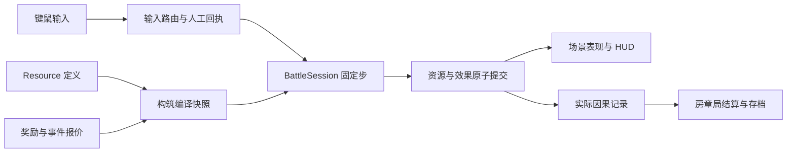

# Godot 迁移实施方案

> 历史归档：2026-10-08 调整范围前的设计、计划或证据。正文中的要求与“下一步”不构成当前任务；当前实施见[交接文档](../../../migration/AGENT-HANDOFF.md).

决策日期：2026-09-27。技术依据为用户提供的[指导方案原文](../../../migration/TECHNICAL-DIRECTION.md)。原文保留来源语境；其中的工具建议和行动表达不是独立授权。本方案按本次授权落实迁移设计与实施准备，完整游戏移植按下列阶段继续。当前完成事实只见[阶段总结](../STAGE-SUMMARY.md)，待办只维护在[TODO](../TODO.md)。

## 目标与交付边界

目标是 Windows 原生 Godot 游戏。保留打字施法、四书关系、主动防御、构筑和成长语义，延续金丝水晶及开放 UI；成长与存档按新游戏建立，不接旧浏览器账号数据。采用类型化 GDScript、Godot 原生 2D、Forward+／HDR 2D。C# 在出现职责独立且收益明确的需求时接入；目前无 `.csproj`、双语言业务或固定 dotnet 构建。

M0 交付根工程、可启动入口、字体／主题／音频总线基础、Windows 导出入口、锁定的本机工具链、迁移设计与阶段验收边界。当时的标题场景只确认资源、原生窗口和工具运行。后续阶段的实际完成范围见阶段总结，不由准备证据推断。

不移植 React、DOM、Vite、WebGL 适配层、浏览器时间循环、localStorage 接口和旧版逐帧轨迹。不要求重新写掉有价值的外部资产处理工具。暂不扩展云同步、录像、任意时刻续玩、跨平台发行和通用 ECS 框架。

- 每次迁移时都要思考在Godot中有没有更好的方式实现同样的需求, 如果有, 那就使用.
- 所有的迁移都要去阅读原项目中是如何实现的, 在当前项目中有没有更好的办法实现, 禁止仅凭借文档想当然.

## 仓库与权威来源

```text
project.godot                 Godot 根入口
export_presets.cfg            Windows 导出配置
app/                          组装、启动、场景切换
assets/                       Godot 使用的源素材；当前为两套字体
audio/                        原生总线与后续音频资源
ui/                           Theme、页面、组件和图谱表现
game/                         按阶段产生的战斗、内容与存档模块
tools/godot/                  CLI、版本锁、MCP 联调工具
.agents/skills/               项目开发、视觉、工具三个简短 Skill
docs/                         有效产品、技术决策与状态
legacy/web/                   连同未提交增量保留的 Web 实现及工具
.tools/                       忽略的第三方开发工具
.temp/                        忽略的日志、截图和生成预览
.delete/                      用户手动清理的待删除内容
builds/                       忽略的 Windows 输出
```

`game/` 是目标职责目录，按实际实现建文件，本阶段不放空壳系统。`legacy/`、`docs/`、`tools/` 有 `.gdignore`，引擎不扫描旧依赖和文档。Godot 自动产生的 `.godot/` 不入库，脚本 UID 与资源 `.import` 配置入库。

同一内容迁移后，Godot Resource 成为活动定义；旧 TypeScript 保留为理解实际行为的源码依据，不双向同步。外部词库／音频索引按明确生成关系导入，不能在 JSON、TS、TRES 中各自手调同一规则。素材的迁移源、保留方式与数据缺口见[迁移映射](DATA-AND-ASSETS.md)。

## 从旧项目理解待迁移的体验

每次实施一个功能或页面，先围绕该范围阅读 `legacy/web/` 的**实际调用链**，再设计 Godot 实现。当前[产品设计](../PRODUCT-DESIGN.md)、专题规范和用户明确反馈决定目标；旧源码说明已有游戏具体怎样运作，其中尚未完成或与当前目标冲突的部分仍按[阶段总结](../STAGE-SUMMARY.md)判断。旧测试、历史文档和截图帮助定位与核对，不能代替源码。

从可见入口或玩家操作追到执行结果：谁接收输入，怎样改变状态，规则在哪结算，结果怎样传给界面、渲染和声音，暂停、取消、快速重复操作及退出时怎样收束。阅读相关内容定义、素材调用和已有测试中的边界案例；只展开与这次迁移链路有关的文件，不要求每次通读整个旧仓库。[代码与素材映射](DATA-AND-ASSETS.md)提供起点，[体验映射](EXPERIENCE-MAP.md)记录已核实的 M1 体验，[UI 迁移实践](../../../migration/UI-IMPLEMENTATION-LESSONS.md)记录一次只看静态外形导致遗漏行为后的修正。

| 待迁移范围 | 首先定位的旧源码 | 继续追查的问题 |
| --- | --- | --- |
| 菜单、词令、设置、指南和图谱 | `src/ui/` 的页面与组件、`src/input.ts`、对应 CSS | 状态切换、焦点和输入归属、正文内容、滚动、悬停、词令、保存与图谱交互 |
| 战斗与四书 | `src/application/SessionController.ts`、`src/simulation/`、`src/content/books/`、`src/rendering/NativeBattleRenderer.ts` | 输入到命中与防御的时序、暂停、目标失效、反馈的触发和持续、四书差异 |
| 构筑、成长、事件与存档 | `src/contracts/`、`src/content/build/`、`src/shared/build/`、`src/simulation/spells/`、`src/application/` | 定义与实际执行、来源和费用、生命周期、获取与配置、普通／God 隔离、重复回执 |
| 画面和声音 | 对应组件及 CSS、`src/rendering/`、shader、`src/ui/useUIAudio.ts`、`src/platform/ThreeAudioSystem.ts`、音效索引与原资产 | 动效何时开始、如何插值或中断、作用于哪些层、与声音如何对齐、减少动态怎样改变表现 |

截图只记录某一瞬间。对动态页面和战斗效果，必须阅读 CSS `@keyframes`／`transition`、组件状态与事件处理、逐帧绘制／shader／粒子、声音触发及时间控制等实际源码；需要确认节拍、连续输入或中断行为时运行旧版对应流程。不能仅凭截图临摹静态构图后，就认定选书过渡、施法反馈、危险预警、入场仪式或其他动效已经迁移。截图用于核对可见层级与关键帧，动态过程还要看实际运行中的起止、过渡、受效范围和交互响应。

读清原实现后，写下这条功能链要保留的条件、结果、内容身份与体验节奏，以及旧版未完成或准备调整的部分，再选择 Godot 场景、Resource、信号、AnimationPlayer、Tween、粒子、shader 或音频总线等合适载体。选择依据是同一玩法目标下的原生表现、运行效率与可维护性；旧类名、Web 循环、CSS 参数和逐帧轨迹不构成必须复制的接口。交付时能指出新实现对应的旧入口与关键行为，并用原生实际交互和动态画面核对，不能只提交外观相近的静态截图。

## 运行架构与状态所有权

| 边界 | Godot 形态与职责 | 权威数据／禁止的隐含依赖 |
| --- | --- | --- |
| `app/` | 根场景组装；异步加载并切换菜单、远征、结果场景 | 持有当前会话引用，避免所有状态堆进 Autoload |
| `game/session/` | `RunSession` 管理房、章、局流程，`BattleSession` 推进战斗 | 流程状态和房间编号唯一；结果一次提交 |
| `game/input/` | `InputRouter` 区分菜单／输入框／战斗；`TypingSession` 管理词进度 | 人工字符回执唯一，UI 和自动补全不能自行发收入 |
| `game/combat/` | 场景中的敌人／玩家／投射物负责局部运动和表现；`BattleSession` 固定步结算 | 生命、目标、受击状态属于战斗状态；节点不另存一份可写血量 |
| `game/spells/` | `ResourceLedger`、`SpellRuntime` 为具名 RefCounted；高频集合用类型化数组 | 所有者、费用、次数和来源先原子提交，再发布表现结果 |
| `game/builds/` | Resource 定义与 `BuildCompiler`，生成会话内只读构筑快照 | 定义和运行实例分开；共享 `.tres` 不保存余额或次数 |
| `game/progression/` | 许可、奖励、事件报价与资产事务 | 永久天赋许可、临时能力、资产实例和来源分别表达 |
| `game/persistence/` | `SaveRepository` 管版本、备份、普通／God 文件空间 | UI 只提交意图，保存系统负责读写与失败结果 |
| `game/vocabulary/` | 导入解析、规范化、索引和词会话 | 外部文件使用数据格式；不加载用户提交的可执行 Resource |
| `ui/` 与战斗表现 | Control、CanvasLayer、AnimationPlayer、Tween、GPU 粒子、CanvasItem shader | 消费已提交状态和事件，不依靠信号连接顺序执行规则 |

以上是目标接口边界，不在准备阶段逐项创建类。公共请求／结果使用具名类型，内容 ID 使用稳定 StringName；字典用于真正按 ID 索引或外部解析，不作整个业务的无类型载体。



规则请求按显式阶段处理：消费本步输入 → 供给／施法与防御意图 → 运动及碰撞候选 → 费用与命中提交 → 死亡及已付后效 → 有界衍生请求 → 生命周期回收 → 汇总显示。各阶段在 `BattleSession` 可读地调度；不通过多个节点的 `_physics_process` 调用先后决定业务顺序。不能为了本步预算截断而吞掉合法结果：有预算的延后请求保留状态，无预算循环在规则编译／事务层拒绝。

节点适用于独立生命周期、可编辑表现和物理交互；小额法术份额、账户、回执和纯查询不扩成节点。第一条完整链使用清楚的原生组合，不先建设全局对象池；出现频繁创建的同类投射物时再局部复用，并在重用时清理来源、插值与信号连接。

## 时间、输入、空间与线程

- 以 60 Hz `_physics_process` 为默认战斗步，秒为运行计时单位。`_process`、Tween 与 AnimationPlayer 负责可变帧表现。高刷新率不提高收入或规则触发次数。
- SceneTree 暂停停止战斗与其计时器，暂停页使用 `PROCESS_MODE_WHEN_PAUSED` 或 `ALWAYS`。时间缩放只影响明确选中的游戏时间；设置、提示和退出交互使用实时时间。命中停顿作为有界表现／战斗状态实现，不能停掉 UI。
- 输入在事件到达时记录意图，下一固定步提交；原始字母用 `InputEventKey.unicode`，只接受真实按下且排除 echo。动作进入 InputMap；Shift 终式在“按下后无组合键、释放”确认，避免 Shift+Tab 误触。Space 留作防御，短语可见空格不计人工收入。
- InputRouter 优先处理有焦点的 LineEdit／TextEdit、模态页和暂停，再路由词令或战斗。失焦清除按住状态；恢复时不补发按键。UI 导航和战斗目标切换不能同时消费 Tab。
- 创建、复用与瞬移实体后重置物理插值，避免拖影。首目标死亡、对象被释放等情况下，以稳定实体 ID／代际和已付请求的目标策略处理，不保存可悬空的 Node 引用。
- 1920×1080 为设计参照，统一字体与世界层的实际输出像素密度，分辨率、窗口／全屏及独立 UI 缩放通过设置管理。当前 Window／HDR 视口的具体缩放接线见[实现快照](../../../TECHNICAL-SNAPSHOT.md)，不把历史伸缩模式固定为产品要求。宽高比扩展外围装饰及 UI 留白；战斗有效区域和敌人出现范围使用显式边界，不跟随可见窗口面积变化，不为多种比例分别维护设计坐标。
- 线程优先用于词库解析／索引、图布局和纯数据批处理。工作线程不读写活动场景树、共享 Resource、渲染对象和账本；持有输入快照，以请求代号丢弃已过期结果，主线程在安全边界提交。战斗规则先保持单一权威线程，不预置多线程调度框架。

## 构筑、资源与完整内容

依据 [D01–D12 及资源语义](../build-system-design/04-SYSTEM-FRAMEWORK.md)重建，而非照抄 `NativeSpellBattle.enabled` 的新旧双轨门控。Godot 不继承“某件旧内容不支持就整次回退 Web 主术”的结构。

采用 Godot 64 位 `int` 保存固定点资源，初始沿用 Q=1024 作为清晰量纲，数值上限和乘除顺序在交易接口校验。费用、次数、所有权转移与回执领取形成同一事务；不足则完全失败。浮点用于运动与视觉，不能在分摊后凭四舍五入创造余额。

基础定义分为 `BookDefinition`、`TalentDefinition`、`RelicDefinition`、`RuleDefinition` 与共享数值模型；`EventDefinition` 的正式出现池和交易模板由 M4 接入。规则 ID 与内容 ID 分离。M3 保留 206 个天赋及起点、171 件遗物，逐项原生入口、费用与验证族见[内容映射](../../../migration/M3-CONTENT-MAP.json)；32 个事件的模式与交接见 [M3 接入说明](M3-INTEGRATION.md)。定义数量不替代战斗情境、正式获取或收益验收。

第一条迁移链把人工字符 → 唯一收入 → 主术 → 命中 → 死亡后已付效果 → 房间清理跑通，再逐族补保存、持续、路径和资产。基础主术、终式、弹反反击、闪避和所有次生来源最终进入同一收入／支出语义；不能重复旧项目“主术迁移但其余伤害仍从旁路产生”的缺口。

运行时新取得内容生成新的构筑快照，在途对象保留创建时的规则和房间上下文。派生、运输、聚合、自动补全不重发人工收入；停止输入后已付过程可有限完成。房、章、局边界明确清理和允许归档的储备，清理不能变成免费结算或返还刷新奖励。

M3 以候选资源语义重塑四书基础战斗：寒墨积寒达到阈值才冻结；穿透、持续、溅射、区域、召唤和传导消费有限份额；辅助方向共用制作预算。基础数值与手感重新验收，M2 的用户验收不自动适用于这些变化。元素伤害包含中性和冰火雷纸，敌人特征初始使用 25% 抗性或弱点；控制抗性独立。R172 首次派发的转换被冻结到该份法术，辅助补全只按真实手打前缀施法。

打字始终是主要进攻来源；基础防御保护输入，强反击主要消耗打字积累的力量。规则接入后还需验证它是否改变目标顺序、输入选择和防御时机，相关设计建议及源码复查依据见[天赋、战斗与打字核心评审](../build-system-design/08-TYPING-AND-BUILD-REVIEW.md)。目录登记、编译和生命周期检查不能替代每项内容实际生效的证据。

执行采用 Resource → BuildCompiler → CompiledBuild → BattleSession／SpellRuntime → 来源账与接触结算 → 表现。`BattleStartRequest` 替代扩张的位置参数；`RunCombatState` 和一次 `RoomCombatResult` 连接房间。新增规则通过封闭操作接入，不建设通用规则虚拟机、ECS 或战斗多线程。原生构筑试验场复用正式代码，只把开发配置存入独立目录；正式获取、成长图与保存由 M4 持有。

## 原生 UI、渲染与声音

用 Theme、容器和锚点重建信息层级；不把 CSS 转成一张长图。金丝纹样与材质放在装饰节点，正文、精确危险预警与 HUD 在不受扭曲和模糊的层。全屏图使用共享视口模型，详情 Control 固定，正文 ScrollContainer 内滚动。布局计算只在内容／图版本变化时发生，缩放与拖拽不重算全图。

Forward+／HDR 2D 为单一渲染基线。M1 制作一组真实主题、字体、正文、金丝消隐和法术亮度参照，M2 起在实际战斗内收敛；不先建设多个引擎对照场景。高／中／低分别调整粒子、尾迹、装饰灯、采样和辉光成本，危险提示及规则对象数量保持一致。减少动态独立控制震动、位移、闪烁；参数根据实际画面定，不在准备阶段填虚假的性能承诺。

使用原生 AudioStreamPlayer／2D 与 Music、Ambience、Spells、Threats、UI 总线。现有音频索引、片段和素材按需复用，浏览器合成程序是声音意图参考。并发、优先级、峰值控制和音乐衔接在 M2／M5 实际混音中确定；不预装外部音频中间件。

## 新游戏存档与内容导入

用户数据写入 `user://`，工程已指定 `Keyabyss` 用户目录。目标文件空间为 `profiles/normal/`、`profiles/god/`、`vocabulary/`、`settings.cfg`。存档封套分别包含 schema_version、content_version、graph_version；JSON 保存结构化进度与记录，ConfigFile 保存设置。采用临时文件、校验、备份和替换，坏档不静默清零。

不建设旧浏览器存档导出、导入、配置转换或进度补偿。新游戏从自己的初始成长开始，普通与 God 分开保存。Godot 版本后续更新时，仍需保护本游戏已经赚到的字符、点数与记录；内容或图拓扑变化造成配置失效时提供重配，不把未知 ID 映射为无关能力。仅坐标或外观变化不退点。自定义词库的文件导入属于独立功能，继续保留。

内置词库保持现有 JSON 源与来源哈希；在 Godot 导入边界规范化并生成只读索引。用户词表继续支持 TXT／CSV／TSV／JSON／JSONL，导入预览与错误定位独立于战斗。中文释义与词形的保存、可见空格、不合规字符、选库限制按产品设计保留。

## 分阶段工作包与出口

阶段说明是实施顺序与验收契约；M1–M5 每项迁移都按上节先读对应旧源码、确认行为和内容，再选择原生实现并检查实际动态过程。任务状态只在 TODO 维护，不复制勾选清单。

| 阶段 | 输入与主要产物 | 最小出口证据 | 前置 |
| --- | --- | --- | --- |
| M0 实施准备 | 指导方案、旧仓库 → 根 Godot 工程、旧实现隔离、工具锁、主题字体、导出入口、详细方案 | 搬迁哈希、冷导入、原生窗口、MCP 图像及日志、Windows 骨架导出 | 本次范围 |
| M1 应用与交互底座 | `app/`、`ui/`、`game/input/`、`game/vocabulary/`；主菜单、设置、选词、词会话和暂停 | 字体先就绪；词形／错字／取消；键鼠焦点；桌面窗口与全屏；UI 真实截图 | M0 |
| M2 单房完整战斗 | `game/session/`、`game/combat/`、`game/spells/`；四书基础主术、防御、终式、敌人、单房胜败 | 真实输入到收益闭环；致死后效；暂停／缩放；固定步与渲染分离；实际手感 | M1 |
| M3 构筑与全来源规则 | Resource、编译、来源账、全来源规则、八种形状、抗性与试验场；全部保留战斗内容，事件政策交接 | 每项内容在必要前置下实际生效；真实输入入口；原子失败与有限收尾；同一正式执行链。剩余功能缺证继续跟踪，构筑体验结合 M4 图模型和 M5 遭遇判断 | M2 |
| M4 天赋图、成长与获取 | 先做图模型、合法分配、程序生成与图谱交互，再接配置／成长保存、奖励、许可、事件资产／期限；60 点为候选标尺 | 真实购买／撤点与模式配置；完整内容生成零交叉近邻图；几何图形及节点分级可读；普通／God 保存隔离；正式报价原子性 | 复用 M3 稳定接口；不等待整体平衡完成 |
| M5 完整远征与表现 | 三章九场、五档、继续周目、记录、完整教学、素材图标、画质分级和混音 | 完整远征各出口；记录只结算新增；UI 人工审查；正式内容无旁路／占位 | M2–M4 |
| M6 统一验收与发行 | 正式内容、合法构筑与场景 → 统一收益／难度评估、长时运行、Windows Release | 后两档成长门槛、合理中等构筑、收益与交互分别通过；无调试桥的干净机运行；许可齐全 | M5 |

M2 不等待全图和全部事件完成，但必须在单房内完成战场、HUD、四书、防御、召唤、接触反馈与连续表现的体验验收；出生区域与冷区位置框架不能延后到 M5。具体纠偏与边界见 [M2 实施经验](../../../migration/M2-IMPLEMENTATION-LESSONS.md)。M3 不以少量样例充当全内容实现；M6 不把已有 Web 测试通过当作 Godot 结论。若阶段暴露业务冲突，先更新对应设计和候选去向，再局部调整，不自动重启整场架构论证。

M4 按[M4 完整实施方案](M4-IMPLEMENTATION-PLAN.md)接入图谱、成长、获取与两章六房控制，实际出口见[M4 验收记录](M4-ACCEPTANCE.md)，算法详细方法见[天赋图基础方案](M4-TALENT-GRAPH-PLAN.md)。后续为 M5 三章九场、Boss 与继续周目，再到 M6 整体平衡和发行验收。构筑的进入顺序、路径代价和战斗选择结合正式遭遇观察；完整收益、成长曲线与难度在 M5 完成后统一评估。资源与购买等正确性问题按影响及时修复，不延后到 M6。

## 验证与回退

原生导入／脚本检查覆盖引擎 API 与资源引用；机制测试围绕账务、输入回执、阶段边界和资产事务使用 Godot 本机测试入口，是否引入测试插件到 M2 以实际复杂度决定。旧 Node 测试可提供失败案例与业务断言，不要求按同一 seed、步数或轨迹等价。页面和效果还须结合旧源码及必要的旧版运行观察，核对触发、过程、中断和结束状态；单张截图不能证明动态行为完整。

图谱验证分为几何／可达证明、实际购买流程和人工画面审查。完整数值与难度在正式内容闭环后统一评估；不逐件遗物起平衡脚本，不扩张为 M0 的前置工程。

每阶段在独立职责范围提交可检查结果，用户已有改动不重置；本次未自动 commit。需要回看旧游戏时，在 `legacy/web` 运行其原工具；Godot 源工程不加载它。移植中撤销一个未完成模块可恢复其文件与场景连接，不依靠覆盖用户存档回退。开发工具可重装或替换，不改变游戏资源格式和业务接口。

## 已知问题及处理时点

| 事项 | 处理决定 |
| --- | --- |
| Web 全内容、图谱、难度本来未验收 | 按 M3–M6 补齐；不能将旧缺口包装成已迁移完成 |
| 字体来源许可未随原仓库完整记录 | 本地开发复用现有源文件；正式发行前补完整来源与许可，见 TODO |
| MCP 固定 9090 且会注入脚本 | 生成预览副本、单实例所有权；工具不是发行依赖 |
| .NET SDK 当前为 9.0.201 | GDScript 骨架不需要程序集；引入 C# 前按锁定 Godot 的 SDK 要求重新核对 |
| 新游戏存档 | 不接旧浏览器数据；M4 建立 Godot 自身普通／God 隔离、去重结算与版本更新规则 |
| 画质档与吞吐容量尚无实测 | 随实际战斗场景定参数；不据标题屏宣称性能改善 |

工具核查依据、版本与复现方法见[工具链](../../../migration/TOOLCHAIN.md)。
