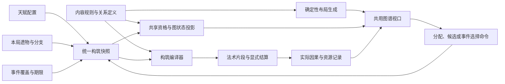

# 战斗、构筑与共鸣图谱：整体重构计划书

> 历史归档：保留当时的方案、状态或检查结果，不作为当前待办、完成声明或实施约束。当前入口见[文档导航](../README.md)。

状态：整体设计与实施契约。涵盖研究结论、整体设计、实施边界和验收方法；本文的目标、机制、数值与界面不能视作已经实现的功能。

代码基线：`a0b447c`，分支 `codex/combat-system-deepening`。该提交保存此前全部未提交改动，包括已有文档整理与工具改动。原始设计依据为 [Combat_System_Refactoring_Plan.md](Combat_System_Refactoring_Plan.md)。

阅读索引：第 1–3 节说明整体目标和三方联动；第 4–8 节定义法术、天赋、遗物和事件；第 9 节定义自动图谱；第 10–14 节给出构筑、遭遇、架构和内容规模；第 15–17 节给出实施与完成标准。数值公式与统一评估详见 [统一收益模型](../COMBAT-BALANCE-DESIGN.md)。

## 1. 要做成什么游戏

玩家持续面对三个相互影响的决定：**天赋决定自己能够怎样组织法术；遗物决定本局实际获得什么零件，以及如何改造这些零件；事件改变获得、连接、演化这些零件的条件和代价。** 三者共同形成构筑，构筑决定一个词完成后发生什么。

目标是一次完整的成长与战斗系统升级。不能以增加几件遗物、扩充几个触发条件、把节点画得更多，作为整体完成的依据。

### 1.1 不可丢失的体验

1. 战斗的前台仍然是选目标、完整打词、移动、闪避、弹反。后台负责已经决定好的材料分配、法术加工、载体消耗和回收；不增加战斗中的接线、选容器、转存或排序操作。
2. 普通敌人继续可以被合适构筑一至两词击杀。一词支付的法术过程能在主要目标死亡后继续展开，不要求小怪充当多轮状态试验台。
3. 同一构筑必须同时有耐久目标和脆弱目标的使用方式。击杀可以改变资源去向，但不能成为所有构筑的唯一发动条件。
4. 打字是持续供给。可以拥有自动工作的召唤物与长连锁，但停笔之后只能花掉有限的存量，不能靠自己的产物无限补齐全部资源。
5. 不以限时完词维护基础联动。慢一些的玩家也能看到完整机制；更快输入自然提高吞吐量，不再附加一层“打慢了就失效”的常规惩罚。
6. 强构筑不会吞掉输入。残响保留原词、释义、已输入位置和错误状态；取消和清房有明确语义。
7. 构筑深度来自取舍。同一个零件在两种构筑中的价值可以反转；同一主副书组合至少能发展出数种执行方式。
8. 图谱应当有宏伟、连通、可探索的规模。天赋图、遗物图共用图模型、确定性布局与交互框架；不能继续给每个节点手填坐标，也不能使用随机散布或随机力导向布局。

### 1.2 三者各自承担什么

| 系统 | 玩家决定 | 负责改变 | 不能替代的部分 |
| --- | --- | --- | --- |
| 天赋图 | 出征前走什么路径，投资什么规则，舍弃什么远端能力 | 法术组织方式、可用的加工规则、主副书关系、专精代价 | 不能在出征前把本局整套遗物和最终输出都配齐 |
| 遗物图 | 本局拿什么、深化什么、向哪条分支演化 | 实际供给者、载体、加工器、释放与回收方式 | 不能只成为给天赋加百分比的装备目录 |
| 事件 | 是否用资源、既有节点或后续风险交换新的可能 | 本局连接、节点变体、材料用途、后续遭遇、有限重构机会 | 不能只是三选一奖励的另一种弹窗，也不能稳定发毕业组件 |
| 战斗 | 先打谁、在哪行动、何时使用既有防御 | 让同一构筑在不同空间、敌人关系和压力下产生不同结果 | 不能要求玩家实时管理后台法术程序 |

天赋和遗物的图不是互不相干的两个大菜单。检查一个遗物时，应能看到哪些天赋会改写它，哪些事件可使它转向；检查一个天赋时，应能看到它接受哪些类别的遗物，以及已有本局事件怎样改变了这条路径。关系来自实际规则，不能由另写一套说明文字猜测。

### 1.3 参考作品的可取之处

- 《流放之路》的官方天赋页面提供大图浏览、搜索、相关节点与路径高亮。这里借鉴的是全局图景、局部阅读和路径规划，而非照搬职业、属性、坐标或美术资源。[官方天赋页面](https://www.pathofexile.com/fullscreen-passive-skill-tree)
- Nova Drift 的开发日志把改变规则、附带显著代价的升级，以及能促使玩家改变构筑方向的选择作为设计内容。这里借鉴的是“拿到之后重新理解其他零件”的机会。[Super Mods 设计](https://blog.novadrift.io/nova-drift-cosmic-powers/)、[Wild Metamorphosis](https://blog.novadrift.io/wild-metamorphosis-launch/)
- Magicraft 的官方介绍强调法术组合产生不同效果。这里借鉴可重组的法术零件；键渊的输入成本更高，因此这些组合应由一次完词自动执行。[官方介绍](https://store.steampowered.com/app/2103140/Magicraft?l=english)
- Brotato 把构筑选择放在波次之间，武器可以自动工作。这里借鉴决策与执行的分工，保留键渊自己的打字发动方式。[官方介绍](https://store.steampowered.com/app/1942280/Brotato/?l=english)

以上为设计参考；后续机制与架构是针对本仓库的方案，不是这些作品已经证明适合键渊的结论。

## 2. 现状研究：哪些基础能保留，哪些必须重新设计

现有输入保护、死亡前后结算、数据分层与 God 数据隔离值得保留。但功能测试通过，只证明这些功能在既定场景中可执行，不能证明已经形成足够丰富的构筑空间。

| 代码事实 | 对深度的实际限制 | 重构要求 |
| --- | --- | --- |
| 当前 20 个天赋节点，四本书在普通 24 点预算下都可选中 19 个，仅花 21 点；唯一互斥是合订/独卷 | 满成长后几乎不必舍弃其他路径；大部分差异只是先后顺序 | 用路径成本、规则分支、关键节点互斥和有限配置形成长期差异 |
| `SpellRoot` 用三个布尔值表示晶体、热性和传导；`primaryClaimed` 限制为第一次人工主命中 | 无法表达材料数量、分配、转移、剩余、加工顺序；为了防循环，一并阻断了大量合理派生行为 | 引入具有归属与份额的载荷，允许受控的再次加工 |
| 纸页保存主书元素、折算伤害和共享根，释放时走通用弹道或一次雷击 | 它不是完整法术的承载者；主雷链、冰矛穿透、混合材料和多数后效无法按规则复写 | 承载法术片段与材料份额，复写描述与复写资源分开 |
| 冰火固定最多三个碎片、传导固定最多两跳，主要集中在 `WeaveSystem` | 看似组合，实际只有少量事先写定的展开方式 | 用分配、加工、承载、释放等可组合操作生成结果 |
| 能力标签主要参与资格与候选权重；同源 grant 常被布尔化或阈值覆盖 | 天赋与遗物提供同类能力时，可能只是重复打开同一个开关 | 对同源叠加制定产量、容量、效率、替换或明确满额策略 |
| 路线选择目前直接处理 heal/hurt/shield/relic，再进入房间或遗物选择 | 缺少可冻结的多选事件、节点变换、代价事务及期限覆盖 | 保留路线与房间入口，建立能影响天赋/遗物作用关系的事件层 |
| 灼烧回收记录在当前 burn 对象的单个数值上；再次施加灼烧会重建对象 | 来源混合与刷新可能丢失回收凭证，难以继续支持更多加工方式 | 按已支付贡献管理可回收剩余，不依赖一个易覆盖的标记 |
| `TalentPanel` 使用固定 viewBox、手写节点 x/y 和直线连边 | 内容扩充会变成手工摆图工作；天赋与遗物无法共享完整图谱能力 | 建立图定义、自动布局、状态投影、渲染交互四层 |
| 已有治疗、加速光环、孵化、镜盾、正面护甲和 Boss 护塔 | 已经存在目标优先级基础，不能把敌人研究简化成“目前只有弹幕” | 扩大这些关系的组合，使不同构筑改变解题方式 |

主要依据：[天赋定义](../../legacy/web/src/content/talents.ts)、[天赋校验](../../legacy/web/src/shared/talents.ts)、[载荷契约](../../legacy/web/src/contracts/combat-weave.ts)、[组合执行](../../legacy/web/src/simulation/systems/WeaveSystem.ts)、[灼烧系统](../../legacy/web/src/simulation/systems/FlameSystem.ts)、[能力集合](../../legacy/web/src/shared/combat-capabilities.ts)、[路线与奖励](../../legacy/web/src/simulation/progression/RewardSystem.ts)、[天赋界面](../../legacy/web/src/ui/TalentPanel.tsx)。代码事实基于本文件开头的基线；不把静态推断写成已经测得的玩家体验。

**保留基础，不保留其表达上限。** 原有数值、层数、图拓扑、候选权重和固定触发次数都需要重新审视；不能为了兼容现有实现而把新系统限制在原来的几个布尔开关里。

## 3. 三者联动的完整循环

### 3.1 一局中发生什么

1. **出征前：**在统一天赋图上规划路径，确定主书、可选副书、规则倾向与代价。能预览相关遗物群，但不能从全图直接领取本局遗物。
2. **前期建立：**首个独立可用的供给或加工零件改变一词的表现。前几次选择就应形成方向，不以三件套齐全作为第一次有趣的门槛。
3. **中期连接：**遗物图展示当前已拥有、可深化、可连接的邻域。候选可能深化已有能力，也可能带来新的材料或另一个使用出口。
4. **事件转向：**事件根据实际能力、持有节点、已走天赋和当前战况产生合法选项。玩家可以付代价演化、替换或临时连接节点，改变下一段旅程。
5. **遭遇验证：**敌人组织方式使某些方案更高效，也暴露其代价。玩家仍通过正常目标选择和防御操作应对。
6. **后期成形：**构筑有明显轮廓，同时留下缺点与继续选择的空间。不能自然汇总为四元素、全部回收、全部防御的通用答案。
7. **战后理解：**图谱保留本局路径，报告解释实际发生过的几条主要因果，并结算跨局天赋点。玩家据此规划下一局。

### 3.2 三向联动的具体要求

| 情境 | 天赋提供 | 遗物提供 | 事件改变 | 实际玩法结果 |
| --- | --- | --- | --- | --- |
| 护页反击 | 遗响：允许在载体终结时交出剩余载荷 | 复写供给、护封、雷性材料 | 用部分最大护盾换取本局“护封优先保留最新纸页”变体 | 新纸页偏防守、旧纸页偏输出；不操作每一张纸页 |
| 炉心回收 | 余热可被封装为下次法术的材料 | 灼烧供给、有限热匣、封装器 | 将热匣演化为高容量低回收率，或低容量高兑现率 | 低血群怪与 Boss 战的资源曲线不同，不是都加伤害 |
| 晶壳分发 | 允许晶壳承受加工并传递内部载荷 | 晶壳、分发器、有限电荷 | 临时开放一种材料进入晶壳的通道，代价是下一房敌人分散 | 传导路径在敌人与载体之间延续，换场景后要重新选主目标 |
| 散字构筑 | 同字母标记可改变载荷分配，仍需完词兑现 | 散字余音、聚字或分字分支 | 将本局“聚集同一目标”的分支换成“分散到更多词条” | 相同输入收益在集中击破和广域展开之间切换 |
| 独卷专精 | 关闭副书槽，开放一种主书的结构改写 | 与该结构兼容的通用零件 | 用一项现有通用加成换取罕见的主书变体 | 单书靠执行方式成立，不靠统一加 30% 才能与双书竞争 |

这些不是按三件内容 ID 注册的专属配方。事件与天赋授予可描述的规则或变体，遗物提供满足规则的对象；更换为另一种合法供给者，结果仍应成立。

### 3.3 三张关系如何组织

- **天赋图：**分配路径、点数、规则前置、互斥；决定长期配置。
- **遗物图：**基础获取、层级深化、分支演化、材料和规则关联；决定本局资产与潜在转向。它允许多前置、替代来源与交叉连接，是图，不强制收缩为单父节点的树。
- **事件关系：**事件定义引用条件和变换，不维护另一份人工关系图。系统从条件、付出和结果推导它与天赋、遗物的关系，按需叠加到共用图谱中。
- **战斗执行图：**由当前构筑编译出来的实际操作关系，是内部模型。它与界面的节点图有来源映射，但不能把玩家的路线边直接当作伤害调用链。

玩家可在同一个“共鸣图谱”入口切换天赋、遗物、当前构筑视图，并查看相关事件。不同视图共用坐标系规则、检索、缩放、详情和关系投影；不把全部关系同时画成不可阅读的线团。

## 4. 法术应成为能被加工和转交的对象

### 4.1 从几个开关改为明确的组成

每次有效完词产生一个人工施法根，以及一份主法术描述。法术至少区分：

| 组成 | 用途 | 例子 |
| --- | --- | --- |
| 发动凭证 | 记录实际人工输入、词会话和供给次数 | 12 个真实输入位置只提交一次 |
| 基础形态 | 定义法术怎样到达和作用 | 矛、弧、刃、爆发、脉冲；不是书名判断 |
| 威力份额 | 可以分配、集中、折算，放大须注明来源 | 一份主术分给本体与三枚碎片 |
| 材料份额 | 有数量、归属、用途和剩余 | 晶体完整度、热量、电荷、复写额度 |
| 加工规则 | 改变形态、材料或生命周期 | 分裂、封装、转交、提前释放、聚合 |
| 寻敌策略 | 为自动阶段寻找合法接收者 | 分散、回到仍存活的原目标、沿近邻传递 |
| 来源与可执行权限 | 说明何时可以复制、回收或再加工 | 人工根、复制片段、回收片段、反射来源 |

**复制描述不等于复制资源。** 纸页可以保留主术的穿透或传导形态，但复制次数、威力和材料必须有独立的已支付额度；不能把父对象中的全部剩余资源再引用一遍。

### 4.2 第一批通用操作

| 操作 | 输入与产出 | 必须有的限制或代价 |
| --- | --- | --- |
| 附着 `Attach` | 将一份材料放入法术或载体 | 从来源扣除，不能同份双持 |
| 分配 `Split` | 将载荷拆给多个子载荷 | 总份额按配置分摊，不能每份都等于完整父术 |
| 集中 `Concentrate` | 减少接收者，增加单个对象的份额 | 放弃覆盖或持续时间，不凭空叠加全局倍率 |
| 封装 `Store` | 将未结算载荷交给承载物 | 消耗容量，推迟兑现，承载物会终结 |
| 转交 `Transfer` | 改变载荷所有者或传递节点 | 唯一归属迁移，旧所有者不能再释放 |
| 改造 `Transform` | 改变已有结构或材料用途 | 消耗可量化的材料或结构；记录变换来源 |
| 释放 `Release` | 将未释放的载荷交给执行器 | 一次性领取；无合法接收者走明确回退 |
| 复制 `Replicate` | 用复写额度建立弱化法术片段 | 不产生人工输入；继承哪些规则必须显式声明 |
| 回收 `Recover` | 收回本来会浪费的未兑现份额 | 折损、容量与来源资格；同份额只能回收一次 |
| 聚合 `Merge` | 将数份兼容载荷装成一份 | 保留不同来源的账，不把来源混成新人工根 |

“冰火裂书”可由可碎裂结构接受热性加工后分配内部载荷产生；“雷纸反击”可由承载物防御消耗后释放电性片段产生。这些内容使用同一批操作，但不要求它们执行完全相同的步骤。

### 4.3 次序有意义，但不让玩家手动排程序

构筑的节点负责声明阶段与规则。例如“先封装再受热”会使纸页提前放出载荷；“先碎裂再封装”会把分配后的片段分别保存。玩家通过不同遗物分支或天赋选择这两种行为，不在战斗中排队。

编译器固定通用阶段：供给 → 装配与分配 → 发射/承载 → 命中准备 → 伤害提交 → 已获后效 → 终结与回收。阶段内用明确依赖和优先级裁决，不能靠遗物获取先后或数组遍历顺序意外改变语义。彼此竞争同一材料的规则必须在内容上声明分配策略或互斥，不能靠谁先读到数组获胜。

### 4.4 一词展开的账目示例

以下数字只解释资源关系，不是最终平衡值：

- 词完成，主术获得 100 份威力；复写节点用本次付费额度额外建立 35 份复制威力；热性供给得到 1 份材料。
- 构筑把热性材料的 0.4 分给即时主术、0.6 封进纸页。两个对象都可呈现火性加工，但总材料仍是 1 份。
- 即时主术的晶壳破裂，把自己的 100 份威力分为本体 55 与三个各 15 的碎片。若遗物提供额外放大，先记录那一笔放大，再分配。
- 纸页被护封消耗：没有遗响，未释放攻击终结；有遗响，领取已有 35 份复制威力及纸页中的剩余材料，按保存的法术片段执行。
- 反击命中可以继续进行符合资格的加工；它既不能新建人工供给，也不能把已经领取的纸页载荷再领取一次。

这样既允许长过程，也不需要用“所有派生都禁止触发”的大开关压平深度。

## 5. 元素、承载、回收与字符玩法

### 5.1 元素在三个层面工作

| 元素 | 敌人层 | 法术层 | 载体层 | 常见机会成本 |
| --- | --- | --- | --- | --- |
| 冰 | 冷却、控制、脆裂窗口 | 结构完整度、收束、穿透与碎裂 | 晶壳保存、集中负载、延迟破裂 | 保存与即时扩散竞争，完整度不能同时花在全部出口 |
| 火 | 直接伤害、灼烧、持续区域 | 热性加工、把储量提前兑现 | 受热改造寿命、烧穿外壳、热量封装 | 更快兑现减少持有时间和防御机会，回收会折损 |
| 雷 | 即时命中、感电、有限传导 | 路径分配、接力、跨对象转交 | 载体作为合法中继，电荷注入或转移 | 更多接收者分薄份额，传递距离与次数需要电荷 |
| 纸 | 原有纸灵、标记与刃击 | 保存片段、复写、折叠、指向继承 | 护持、交付、聚合、终结释放 | 占用容量，复写折算，攻击与防御竞争同一载荷 |

元素是材料与行为的来源之一。资格应区分 `material.thermal`、`structure.fracturable`、`container.payload`、`transport.conductive`、`exit.defense` 等功能，不能用“有冰书”“有纸书”替代真正需要的对象。属性标签描述事实；实际行为由操作执行器承担，不能期待标签自动产生涌现。

### 5.2 载体是通用生命周期，纸页只是一个实例

第一批承载对象包括复写页、晶壳和有限回响。纸灵在移植其攻击/返回周期时可以运输载荷，但常驻纸灵的存在不等于无限弹药。

统一生命周期为：建立 → 装载 → 等待/移动 → 领取一次出口 → 终结。出口包括正常攻击、防御消耗、主动受热释放、寿命终结和场景清理。

- 攻击与防御不能各自消费同一份载荷；同帧竞态使用统一的出口领取操作。
- 遗响授予“终结时交出剩余载荷”的规则，不免费提供载体、威力或材料。
- 无目标时可保留到本房间的下一个合法时机；到期后按内容规则回收一部分或丢弃。只有场外明确投资的储备可跨房保存，不能让在途弹幕跨房刷怪。
- 满容量时优先保留尚未消耗的原资源或拒绝本次装载；不能先扣掉一份材料，再无记录地把对象丢掉。
- 终结的载体不能被“复活”后再次领取同一出口；新对象须有新的额度与 ID。

### 5.3 来源精确的持续伤害与回收

灼烧不能继续用一个总强度加单个可回收标记表示所有来源。使用有界的贡献片段，至少区分人工投入、复制投入、转交和已回收投入。每份记录已付威力、未结算余额、计划释放速率、到期时刻和回收资格；可持续输出的总额与每秒输出速率分开管理。

- 接纳新贡献前检查储量与片段容量，只提交可接受份额。拒绝的部分仍属于原片段，走其声明的其他出口或记录为损耗；拒绝本身不是一次可获利的回收。
- 每次燃烧结算先按各份计划速率求出本次可释放量；遇到输出速率上限时按这些量同比分配，取整余量按贡献 ID 稳定分配。逐份扣除实际提交的威力，再进入伤害减免；护甲、阶段护盾和过量伤害不会返还为可回收热量。
- 被速率上限延后的余额仍有原来的到期时刻。普通重复施加只新增已支付贡献，不延长旧贡献；专门的保存规则可改变旧贡献的时间安排，但必须有代价和寿命上限，且不得增加余额。到期仍未兑现的部分只按已有回收资格结算一次，否则损耗。
- 不再沿用“层数封顶、伤害取最大、刷新整组时长”后又把各来源理论总量相加的算法。可合并贡献必须具有相同的结算、到期和回收语义；合并后仍能追溯各来源份额。

回收按实际未结算的贡献计算。节点可分别改变回收率、容量、使用方式和可接受来源；增加容量不默认增加回收率。回收产物可以参与转换，但若允许再次回收，必须额外消耗不可再生额度并保证净存量下降；首个完整版本默认禁止同份回收产物再次回收。

除击杀回收外，储备分支提供需要投资的**续写抽取**规则：每次新的人工完词，在本次命中前，从本房最近一次人工命中的仍合法存活目标上，抽取属于本构筑且有资格的既存灼烧余额。目标按已提交人工命中序号确定；没有合法贡献就不抽取。抽取比例受规则限制，先从原贡献扣账，再折损存入储备，最早供下一次人工完词使用。它牺牲目标后续持续伤害以换取再分配，不同时保留两份收益，也不要求限时续词。

死亡、到期与续写抽取共用同一余额领取流程。回收分支由此能在耐久目标上周转，但击杀专用节点仍可偏向群怪；不要求每件遗物在所有遭遇中收益相同。

加入多余电荷、未使用晶壳和未命中片段的有限回收支路，但不把它们统一折成无类型的“额外伤害数”。不同材料应保持不同用途，事件也才能改写它们的去向。

### 5.4 字符层提供构筑差异，完词仍是中心

- 用稳定的词会话记录人工接受的位置。错字不供给，辅助补全部分不供给，取消后未完成的常规材料不结算；残响延续同一会话，不能重复提交。
- 基础材料仍在完词时提交。字母飞行、结构显现等反馈可以提前出现，但不得由视觉事件发放材料。
- 散字余音保留每个字母的独立形态、随机初始飞行方向与平滑噪音轨迹；这里的视觉随机与图谱布局完全无关，不使用玩法 RNG。
- 同一输入位置最多生成一次散字凭证；同一词条位置只能持有一个标记；兑现必须再完成接收词的实际人工输入。散字和残响可共存，不重复记作两次人工供给。
- 扩展聚字/分字、长词承载、短词周转、标点结构等分支。它们改变分配与容量，不把更快输入作为节点能否工作的前置。
- 当前每个已兑现标记提供 15% 主术增伤保留为基础规则；后续分支可以把一部分标记收益改为载荷或护持，但必须明确替换关系，避免“同一标记全部领取”。
- 词条来自玩家所选词库。带空格短语作为独立输入扩展阶段：显示保留空格，输入流在边界自动越过空格，空格键继续弹反；不加入需要 Shift 或额外战术键完成的常规词条。此项须通过实际输入验证后才进入遭遇内容。

## 6. 天赋图：决定组织规则和长期方向

### 6.1 图的规模与构成

完整内容目标为约 **140–180 个天赋节点**，包括四个主书起点、提供实际收益的路径节点、规则节点、关键改写节点与跨区域连接。数量是制作规模预算，不是质量验收；不允许复制大量无意义的微小百分比来凑规模。

普通分配继续采用跨局积累的点数和有限预算；首轮平衡保留现有 24 点上限作为标尺，重新设计路径成本。完整图的可购买总成本应显著高于预算，单局配置只占其中一个有限区域及少数跨区连接。任何起点都不应在满预算时取得全部核心规则。

节点分四层：

1. **路径节点：**支持已知方向的小幅收益，如载体容量、转交距离、热量保存、晶壳强度；每步可理解，不能纯交过路费。
2. **规则节点：**开放遗响、封装、旁路传递、剩余回收等操作；需要实际供给者才能执行，图谱明确列出兼容来源。
3. **关键改写：**改变一类法术的默认组织方式，并附带代价。普通配置建议最多激活两个；这是构筑约束，God 无限点也不自动绕过。
4. **跨区连接：**提供不同成本的跨元素路线，防止全图被一个中央节点控制；它本身也可提供适量相关收益。

主书决定免费起点、基础形态与原生能力，不决定只能在哪一片区域发展。不同起点到同一规则的代价不同，但最终都能跨区。

### 6.2 关键改写的候选设计

| 方向 | 改写 | 代价及后续遗物空间 |
| --- | --- | --- |
| 完整晶页 | 更多份额留在单个高完整度晶体内 | 分发能力下降；可用遗物选择穿透、保存或强制破裂 |
| 碎镜书写 | 晶体破裂后以多个合法片段展开 | 单体控制与集中威力下降；可用聚合器在特定条件收束 |
| 冷藏抄本 | 允许未释放的兼容载荷进入晶壳保存 | 即时兑现下降、容量有限；与热性释放形成取舍 |
| 炉心封装 | 剩余热量优先成为可承载材料 | 普通灼烧或即时附伤让出一部分份额；载体成为新投资方向 |
| 灰烬归卷 | 回收更偏向跨目标延续 | 单次爆发效率下降；低血目标与耐久目标收益曲线不同 |
| 焚页速写 | 热性加工显著提前载体出口 | 防御留存下降；需要遗响或及时交付才有价值 |
| 远枝共鸣 | 载荷允许沿更多合法节点接力 | 每次份额与最大跨距受电荷约束；既可经过敌人也可经过载体 |
| 孤雷定本 | 把原有多目标分配集中为更少的落点 | 广域覆盖下降；溢出与回收可由遗物重新利用 |
| 并行传页 | 在多个载体间分发有限电性载荷 | 每份减弱、容量压力增加；不能让所有节点复制整条链 |
| 以守代发 | 将部分载体留作防御出口 | 正常自动攻击减少；遇到少弹幕敌人时存在真实代价 |
| 行间编队 | 纸灵可在运输与攻击间分配周期 | 运输会占用原有攻击时间；带来移动中的交付与回流 |
| 独卷精修 | 放弃副书，选择主书的一种结构强化 | 不再是通用 30% 加伤；仍接受遗物和事件提供的其他功能零件 |

这些是关键节点的机制清单，不是最终节点命名或全部数值。每个关键节点必须至少对应两条不同遗物发展路线，并能被一次事件有代价地改写局内用途。

### 6.3 合订、专精与事件借阅

- 合订开放副书的稳定材料来源；它不自动开放该元素所有加工规则，也不同时运行第二套完整主书施法循环。
- 天赋和遗物提供同种功能时，合并方式逐项定义：增加产量、提高容量、降低损耗、替代默认出口或明确互斥。不能再让大量额外投资只把 `true` 写成 `true`。
- 独卷至少有数种主书结构方向。舍弃副书后获得可改变执行形态的空间，不使用一个全局倍率概括所有单书玩法。
- 事件可以提供本局借阅规则或临时连接，但须有代价、范围和来源；不永久改写账号天赋分配，也不能无代价绕过关键节点互斥。
- 天赋在出征前与战后自由重配；本局继续周目保留出征配置。事件修改的是本局覆盖层，并在图谱上有可查的来源。

### 6.4 跨局进度与 God Mode

保留普通局按实际完成字符积累、结算去重、继续周目只算增量，以及 God 独立配置和清理能力。初始两点与每 120 字一点是现行标尺，不把它们当成已经经过新图规模验证的最终成长曲线。

扩图不等于强迫长期刷取才能看到基本联动：起点相邻区域须能用初始预算建立可感知的小机制，首条规则路径可尽早完成。后续成长应主要扩大可选择的配置空间，而不是把所有节点永久自动点满。

God Mode 免点数限制，但正常规则预览仍遵守互斥与合法图关系。专供开发的冲突构筑测试应是独立调试入口，不混入普通 God 配置。新增图谱发现记录、事件记录与本局借阅资料同样区分普通/God；清理仍不影响普通存档。

## 7. 遗物图：大规模零件、演化与交叉连接

### 7.1 内容规模与图的意义

目标为约 **120–160 个有独立行为或明确演化意义的遗物定义**。现有遗物需要逐一归类、改造和迁移，不默认全部原样保留后再堆一批新名称。层数数字本身不当成新的独立内容计算。

遗物图包括四类真实关系：基础/深化关系、互斥演化关系、能力连接关系、事件可改写关系。一个加工遗物可以接受多种供给来源；一个遗物也可同时连接天赋与事件。图中不能把“都带火标签”误画为“必有额外联动”。

节点状态区分：本局持有、当前可获取、前置未满足、互斥、已被演化替代、仅规划。状态改变不重新布局，玩家能够建立空间记忆。全部内容可检索和阅读；不靠长期隐藏说明制造假深度。

### 7.2 十二个主要机制族

每族规划基础件、独立可用的强化件、至少两个结构分支，以及跨族连接件。族是整理内容的入口，不是限制组合的职业。

| 机制族 | 基础作用 | 分支 A | 分支 B | 可形成的三方联动 |
| --- | --- | --- | --- | --- |
| 复写与抄录 | 使用付费额度复写法术片段 | 多份轻载 | 少份重载 | 天赋决定继承规则，事件改变片段可接受的材料 |
| 装订与护持 | 保存未释放载荷并提供防御出口 | 低容量高可靠护持 | 高周转低留存 | 遗响改变终结出口，事件调整保留策略并收取代价 |
| 晶体与容器 | 建立可受加工的结构 | 高完整度集中 | 易碎广域分发 | 冰区天赋改变破裂意义，事件将同一结构改造成储备容器 |
| 热性与炉心 | 提供有限热性材料 | 持续燃烧 | 提前兑现载体 | 回收/焚页天赋改变用途，事件交换容量与效率 |
| 电荷与接力 | 在合法对象间转交份额 | 远距少跳 | 短距多跳 | 传导天赋允许载体中继，事件开放临时桥接对象 |
| 寻敌与几何 | 改变自动接收者和覆盖方式 | 去重分散 | 追踪集中 | 天赋设分配方式，事件使下一段遭遇稀疏或密集 |
| 储备与回收 | 保存尚未兑现的合法投入 | 大容量低效率 | 小容量高效率 | 天赋扩展可回收类型，事件允许转换储备的用途 |
| 碎片与聚合 | 处理已有分散片段 | 二次分发 | 兼容片段归并 | 晶体或雷区规则改变形态，事件牺牲一条分支换另一条 |
| 纸灵与运输 | 原有召唤攻击可运输有限片段 | 运输优先 | 攻击优先 | 纸区天赋允许装载，事件授予暂时的回航加工 |
| 字母与词形 | 使用真实输入和标记凭证 | 聚字集中 | 分字展开 | 天赋改变兑现出口，事件调整标记分配而非替玩家打字 |
| 弹反与防御转换 | 让已执行的防御改变合法资源去向 | 保留与回补 | 回敬与消耗 | 防御天赋、载荷遗物、风险事件共同决定以守代攻 |
| 独卷与代价 | 用放弃某种通用性换结构优势 | 主术集中 | 主术持续展开 | 独卷天赋选择结构，事件和遗物围绕结构提供不同补足 |

每个机制族必须与至少三个其他机制族存在实际可执行连接，其中至少一条涉及改变资源用途或生命周期，不能全部只是伤害加成。

### 7.3 演化不是层数再加一

以复写为例：基础节点允许有限复写；深化节点改善缓存或片段继承；两个演化节点分别改变分配结构。选择演化后，继承的部分和被替换的部分明确列出，不能同时把两条分支的优势全留着。

有些节点可由不同路线到达：高层封装器可以接受纸页、晶壳或借阅回响，不强制要求同一件低阶遗物。但涉及同一家族的身份演化时，仍可要求具体父节点。能力前置与血统前置必须区分。

每次候选显示“这次选择实际改变什么”，例如新增一个防御出口、把当前两份片段改成四份、扩大剩余热量容量。若已经由其他来源达到相同上限，则给出真实增量或明确满额，不把零收益节点作为正常强化候选。

### 7.4 候选系统与探索

候选从实际构筑的可行连接计算，而非仅检查粗标签。保留深化、连接、探索三类机会，但不固定每次各发一张，也不把所有概率集中到系统认定的最佳方向。

权重考虑：节点独立可用性、当前已有的实际供给、前置接近程度、重复展示历史、已拥有层级、分支资格及本局事件。每项权重有上限；探索项保持非零且可测的机会。

路线目标和图上规划只帮助玩家阅读。默认不因玩家在图上收藏某节点而暗改掉落；若将来提供定向寻书事件，须把它作为明确有代价的选择，而不是隐藏保底。

普通三选一仍是主要获取方式。完整遗物图允许查看、比较和规划，不允许点击任意亮起的节点直接绕过本局奖励。事件则提供有限的替换、演化、借阅和受条件约束的连接机会。

## 8. 事件系统：让天赋与遗物在一局中重新发生关系

事件由前置、参与对象、可选代价、状态变换和后续影响组成。第一批目标为 **18–24 个事件模板**，模板可以根据实际构筑产生不同的合法选项；不通过换标题重复发固定奖励来计数。

### 8.1 事件能力目录

| 类型 | 改变什么 | 示例选择与代价 |
| --- | --- | --- |
| 修订 | 替换某遗物的结构分支 | 牺牲一个已有层级或一次后续奖励，换成另一种分配方式 |
| 借阅 | 暂时获得一条合法规则 | 本章获得遗响的有限使用资格，同时降低载体容量；不改永久天赋 |
| 接页 | 建立一条本局可用的跨图连接 | 接受下一房高压力，允许一种已有材料进入原本不兼容的容器 |
| 熔铸 | 把一个真实资源出口改为另一个 | 降低灼烧续航，换取对载体的热性加工；不会凭空附送完整供给链 |
| 归档 | 保存或整理本局取得的节点 | 放弃即时回复，保留一次后续演化候选；不保证特定毕业节点 |
| 校勘 | 调整词形或散字的使用方式 | 聚字转分字，或把部分标记增伤换成护持；需实际持有相关来源 |
| 契约 | 用后续遭遇换当前构筑能力 | 获得一次兼容片段聚合，下一房出现公开提示的分散编队 |
| 试炼 | 在实际战斗中兑现有风险的构筑选择 | 完成指定房间目标后给受约束的演化机会，失败保留已拥有基础件 |

同一事件至少有一个无需特定构筑也可选择的有效选项和一个退出选项。特定天赋/遗物带来的选项是额外机会，不是用关键词把其他玩家锁死。代价必须在选择前可读，不用失败后才揭示的随机毁坏制造难度。

### 8.2 三方关系的实现规则

- 条件引用功能、实际持有状态、天赋规则与本局事件历史；只有有意的剧情身份或家族演化才引用具体内容 ID。
- 结果可以增加一个本局变体、替换一条规则、迁移既有节点的本局作用关系、改变下一段遭遇；不能直接修改不受追踪的全局数值。
- 事件结果进入统一构筑快照，重新编译规则，再投影到天赋/遗物图。图谱上可以追溯“原节点 → 事件变体 → 当前作用”。
- 事件不能让同一纸页既被牺牲作为代价，又保留可释放的载荷；选择采用原子事务，所有条件与支出成功才提交。
- 同一次事件只有一个结算凭证；重复点击、页面恢复、重复读档不能再领取。保存失败不静默留下半套永久进度。
- 临时规则有明确范围：本房、本章或本局。到期停止新增资格与资源承诺；已支付片段按下述有限收尾规则处理。图谱保留历史，但不继续赋予新的能力。
- 事件带来的连接遵守同一套互斥、材料归属与运行约束。不能靠事件把两个禁止并存的关键规则悄悄全开。

### 8.3 到期、在途与清房的边界

到期以模拟时钟为准，在该时刻的新输入与新资源预留之前处理。事件说明与预览必须体现以下规则：

- **未来资格：**借阅规则立即停止接受新供给、新装载与新预留；持续作用的全局加成立即结束。未支付的计划取消，不能把排队意图当成既得资源。
- **已支付承诺：**在到期前已经成功预留全部资源的片段，保存创建时的规则快照、可执行出口与有限寿命；已装载或在途的片段可在本房按这份快照完成一次。不得补领过期规则、延长寿命或产生新的未付费承诺。仅保存了一张旧纸页不代表可以在到期后为它补装借阅能力。
- **已取得后效：**伤害已提交的回执把本次合法后效结算完；它不能再申请到期后的新供给。快照中的局部操作与即时全局加成分别计算，避免把全部旧加成永久封进弹幕。
- **容量收缩：**已预留的在途片段不回塞储备。占用借阅载体容量的已付对象有限收尾期间禁止超额新建；纯储备按存入序号保留最早的合法份额，超出新容量的部分终结为损耗，不转成伤害、回复或另一笔回收。损失在借阅预览中可见。
- **跨房清理：**房间切换不继承上述房内收尾权限。先完成已经提交的当前命中事务，再终结本房载体与在途动作；仅明确允许跨房的剩余储备按合法容量转存。无目标、失效与损耗均留下去向，不能在下一房补发攻击。

同一帧到期与命中竞争时，先清理未来资格，再让之前已预留的片段按其快照命中；若同时触发清房，完成当前已提交事务后执行清理，下一房不得继承攻击队列。

### 8.4 出现节奏

章节应有建立、选择、验证和转向的节奏。事件不在每次升级都插入，也不在激烈战斗中弹窗。路线预告事件主题与风险类型；具体选项根据进入时的真实构筑生成并冻结。

建议每章有一至两个值得阅读的事件机会，搭配可选风险路线；先在内容基线场景中验证阅读频率，不把这个数量当作固定每章必发配方。连续事件不能总是同类收益，也不能稳定把玩家引到某套毕业构筑。

## 9. 共用图谱系统：自动生成、确定、宏伟且可读

这是独立的核心交付，不能放在内容做完后当作美化补丁。天赋图和遗物图从第一阶段就使用同一条数据到画面的链路。

### 9.1 四层职责

| 层 | 输入与输出 | 不承担 |
| --- | --- | --- |
| `GraphDefinition` | 节点、语义区域、类型、关系、条件、成本与来源 | 不存节点 x/y，不写每条边的控制点 |
| `GraphLayout` | 根据完整图定义生成稳定节点位置、簇范围、边路由与空间索引 | 不读取 RNG、账号、选中状态、窗口尺寸决定拓扑位置 |
| `GraphProjection` | 计算已点亮、可达、互斥、候选、事件覆盖、路径预览 | 不重新摆图，不复制另一套战斗资格逻辑 |
| `GraphViewport` | 平移缩放、分级显示、焦点、键鼠导航、详情与检索 | 不硬编码天赋或遗物的规则 |

天赋适配器提交点数与分配状态；遗物适配器提交本局资产、演化与奖励候选；事件适配器提交本局变体和条件关系。三者使用同一节点身份、边解释、视口与详情机制，不能只共用一个画圆组件。

有独立结构意义的事件变体作为潜在节点编入完整定义，在内容构建时就生成坐标；未获得时仍可查看其条件。仅改变参数、资格或期限的事件实例使用原节点的状态与详情投影，不创建新的布局节点。稳定的 `definitionId` 与本局 `instanceId` 分开，任意实例数量都不改变图的节点位置。

事件新增关系只连接已有定义的固定端点；运行时沿布局产物中的通用走廊确定性计算覆盖边，按端点及关系 ID 排序，不重新布局。若确需新的 AND/OR 关系节点，也必须预先包含在完整定义中。创建、撤销或到期只改变投影与关系显示；所谓迁移指作用关系迁移，不是把节点移到另一处。

### 9.2 布局算法的明确选择

采用**确定性的分区分层布局，加区域内环形簇组织**。整体呈现有道路、分支、关键汇聚点的图景；不采用随机初始化的力导向布局，也不通过固定随机种子把随机布局改称确定布局。

生成管线：

1. 规范化全部节点与边，以稳定 ID 排序，校验引用、条件和关系类型。
2. 按材料、生命周期角色和内容家族建立语义区域。内容可声明家族与主要功能，不允许写坐标、角度、轨道编号等布局暗号。
3. 根据起点、成本与进阶关系计算层级；跨区域关联边不强行成为解锁父边。多前置用关系节点表示 AND/OR，不能把一条线误读成全部条件。
4. 使用稳定的分层排序和固定轮数的交叉最小化，所有并列情况按 ID 裁决。节点按角色采用统一尺寸和标签占位。
5. 把局部相关节点组织为可辨认的环形或扇形簇；根据簇占用自动安排区域位置和连接走廊。宏观位置由图数据和算法生成，不由人逐簇拖拽保存。
6. 对碰撞、间距、关键路径与边穿节点进行确定性的约束修复；使用固定迭代轮数和量化坐标，不以执行时间或随机扰动终止。
7. 输出带 `graphVersion/layoutVersion` 的布局产物、空间索引与布局诊断；在内容构建时生成，游戏加载现成产物。

同一图版本在相同布局版本下，重启、切书、账号不同、图上分配不同、窗口大小不同都使用同一份世界坐标。窗口改变的是相机，不是节点位置。新增内容可以改变受影响区域；通过稳定区域 ID 和局部打包减少漂移，不承诺任意大改图后所有坐标永远不变。

布局生成失败必须报出具体冲突和节点，不通过藏节点、删除关系或让设计者补几个坐标绕过。必要时调整的是通用算法或语义分组，不是为单个内容加位置特例。

### 9.3 宏伟图景的视觉结构

- 使用大世界画布而不是固定 `860×530` 小画布。四个起点、材料区域、承载与回收区域、跨区通道共同形成整体轮廓；天赋图与遗物图具有一致的视觉语法。
- 远景显示区域、关键节点与主干，能看懂自己只探索了整体的一部分；中景显示节点名、路径和分支；近景显示状态、成本与细节。不是把所有标签缩到无法阅读。
- 已走路径亮起，未走路径保留可辨的弱纹理。关键节点有独立 SVG 图案，普通节点也按功能使用可辨识图形，不用 emoji 或一批无法区分的圆点。
- 稀疏图案、区域纹理和光效营造尺度；场景承载氛围，仍遵守开放式 UI，不增加矩形底板和四边框。
- 所选节点的前置、去向及天赋/遗物/事件关联分层展开；远端关联用可跳转的入口和局部高亮处理，不常驻绘制所有跨图线。

### 9.4 必须一起交付的交互

平移、以指针为中心缩放、缩放到所选、回到起点、全图概览、搜索、按功能检索、关系高亮、路径成本预览、互斥说明、分支对比、撤回影响预览，以及当前构筑在两图之间的定位。

键盘采用空间方向导航与搜索定位，节点焦点可辨且能自动进入视口。缩放或筛选不改变已选节点身份。标题、返回、图层开关、点数/资产摘要和主要操作固定；只有图视口和详情正文滚动。

遗物图中的“规划路径”与“本局可领取候选”清楚区分，点击路线不是购买。事件选择的结果预览借用同一图投影，展示哪些节点失去、哪些关系新增及代价，不再另写一幅静态关系插图。

### 9.5 渲染与性能取舍

首选 SVG 图层配合统一相机、空间索引、视口裁剪和分级显示。该规模优先保留清晰文字与可访问节点语义，不为了几百个节点直接引入另一套 WebGL 游戏引擎。平移缩放不触发全图规则重算，也不让所有节点每帧 React 重渲染。

用完整内容规模验证后再决定是否把大量静态边移到 Canvas；即使替换边渲染器，图定义、布局、投影和交互契约保持不变。新依赖须有明确收益与体积评估，不能以引入图库代替确定布局设计。

### 9.6 图谱验收不能只看一张截图

- 布局产物在重复构建时坐标与路由哈希一致，源码与生成器没有随机初始化、手填节点坐标或单节点位置特例。
- 满规模内容无节点重叠、关键标签碰撞、边穿节点；AND/OR、互斥和仅关联边可区分。
- 三种状态投影切换不改变世界坐标；搜索、点亮、撤回、事件覆盖不使其他节点跳动。
- 分别验证预定义变体与参数化事件实例的创建、撤销、到期：坐标哈希不变，原节点及变体可追溯，新增覆盖边不穿节点且能辨认端点；不能以临时新增无坐标节点兜底。
- 在 1024×640、1920×1080、3440×1440 和 3840×2160 桌面视口检查可操作性；不增加移动端要求。
- Python 浏览器自动化验证焦点、路径、缩放和固定操作区；截图同时检查远景的规模感、中景的路径、近景的内容，不只证明节点存在。
- 完整图的生成、打开、平移和筛选分别测量；阶段验收目标为首开可交互不超过 500 ms、常用交互帧 p95 不超过 16.7 ms，在注明的测试机器与场景上验证。这是目标，不是当前已取得的成绩。

## 10. 用完整构筑验收三者联动

至少制作下列十二套可实际游玩的验证构筑。它们是覆盖不同规则的试验样本，不注册成游戏里的十二个配方，也不成为奖励系统暗中追求的毕业目标。

| 构筑样本 | 天赋选择 | 遗物发展 | 事件转向 | 面对 Boss 或无击杀场景 | 真实代价 |
| --- | --- | --- | --- | --- | --- |
| 霜焰裂书 | 碎裂与热性加工 | 晶壳 → 碎片分发/聚合 | 牺牲一个覆盖分支换集中出口 | 未击杀也能按命中条件加工；聚合支路保留单体用途 | 分散会降低单点威力与控制完整度 |
| 冷藏抄本 | 封装与保存 | 晶壳 + 复写 + 容量 | 用后续奖励换一次提前释放规则 | 等待合法出口，仍能输出已支付片段 | 延迟、容量与防御机会互相竞争 |
| 雷纸护封 | 遗响 + 防御出口 | 复写 → 护封 → 留存分支 | 以护盾上限换载荷保留策略 | 普通发射仍能工作，不能只靠敌弹出现 | 防守预留会减少主动输出 |
| 雷纸连刊 | 分配 + 正常交付 | 同一复写基础 → 速朽/分发 | 改为高周转低单份的事件变体 | 有效单体片段可收束，不能依赖额外小怪 | 防御留存和单份强度较低 |
| 火纸焚页 | 热性加工 + 终结规则 | 热源 + 纸页 + 有限封装 | 暂借一种兼容出口并降低容量 | 持续输入带来有限周期，不需等待击杀 | 生命周期缩短，缺少终结出口时投资价值下降 |
| 冰雷接力 | 导流 + 晶壳中继 | 电荷 + 晶壳 + 寻敌几何 | 后续遭遇更分散，交换一次远距接页 | 可将有限份额送回仍存活主目标，但须有对应分支 | 多跳、距离、集中份额不能同时最大化 |
| 炉线回流 | 热量封装 + 传导路径 | 热匣 + 电性运输 + 续写抽取 | 高容量低效率或相反 | 人工完词抽取既存热量，扣除未来灼烧后折损入库 | 保存热量会让出即时附伤或持续收益 |
| 行间送焰 | 纸灵运输 + 热性装载 | 纸灵 + 热源 + 回航加工 | 用攻击周期换本章特殊交付方式 | 运输仍占用真实周期，持续投送有限片段 | 纸灵自身攻击次数减少 |
| 冰书独卷 | 完整晶页 + 专精 | 穿透/收束 + 晶体回收 | 用一个通用节点换主书变体 | 集中和穿透针对不同编队，可直接处理耐久目标 | 无副书供给，需通过通用遗物补足 |
| 雷书独卷 | 孤雷定本 | 集中落点 + 剩余电荷处理 | 将远跳机会换成有限二次兑现 | 不需要靠多目标才能有核心收益 | 广域清场弱，需要目标选择 |
| 火书独卷 | 灰烬归卷 | 持续热量 + 两种回收分支 | 回收储备改变为本局封装材料 | 活着持续灼烧，死亡收回实际剩余；两者不重复结算 | 更高储备不等于更高回收率 |
| 散字编织 | 字形兑现规则 | 散字 → 聚字/分字 + 兼容载体 | 把一部分增伤改为护持 | Boss 可用词内标记或普通主术路径，不强制刷小怪 | 需要真实输入，不能自动标记自动兑现 |

### 10.1 每套必须做的反事实检查

1. 去掉关键遗物，剩下的构筑仍能游玩，失去的是清楚可解释的行为。
2. 保留遗物、换掉关键天赋，实际法术过程发生变化；不能只让面板数字变化。
3. 保留天赋和遗物，选择同一事件的另一选项，后续资源去向、风险或发展路径不同。
4. 将其中一个材料来源换成同功能的另一本书、另一个遗物或合法事件借阅，仍可执行规则。
5. 让首目标只有 1 点生命，已支付后效仍成立；让它足够耐久，构筑也有核心用途。
6. 在同一个输入预算下更换敌人分布，能够看到集中、覆盖、保留、周转的不同价值。

三者联动的验收不能只验证“这个事件要求某天赋且奖励某遗物”。必须验证事件改变之后，天赋对遗物的实际解释发生了什么变化。

同一主雷副纸还应能走集中蓄册路线：用聚合与容量节点保存若干有限雷性片段，以更少落点释放；事件可交换集中阈值和正常交付效率。这与护页反击、快速连刊共享材料来源，但输出时机、覆盖和防御代价不同。所有十二种有向主副书配对均需至少三种不同的执行拓扑检查；上述十二套承担更深的事件、遭遇和玩家流程验收，二者不能互相替代。

## 11. 敌人与遭遇：为不同构筑提供不同的题目

### 11.1 先扩展关系，再增加模型数量

现有祭司、缚页者、母巢、镜盾、正面护甲、分裂体和护塔已经提供可复用的基础。优先把它们组织成有不同应对方式的编队，再补充必要的新单位和词条机制。

| 遭遇关系 | 目标选择与空间问题 | 不同构筑的应对 | 应避免 |
| --- | --- | --- | --- |
| 护卫与治疗 | 先拆辅助，还是通过覆盖一起处理 | 穿透、分发、控制或集中突破 | 把普通怪血量拉高到必须叠十层状态 |
| 分散中继 | 合法目标间隔较大 | 远距传导、载体中继、机动贴近 | 单纯让近战或短链完全无法命中 |
| 密集繁殖 | 源头继续制造压力 | 优先击破源头或用分发控制场面 | 杂兵无限生经验形成无风险挂机 |
| 护甲与侧向 | 主术来源和入射方向有意义 | 绕行、纸灵交付、穿透或控制 | 元素硬免疫、指定某书才能过 |
| 弹幕与空隙 | 防御资源和输出资源的取舍 | 护封反击、主动闪避、集中清除来源 | 护页自动永久免疫所有危险 |
| 词形与标记 | 多词条的可输入性和收益不同 | 散字分配、长短词方向、直接选目标 | 临时改掉已输入的词、颜色阅读谜题 |

至少制作八种可复现的编队模板，每种都有普通压力与后期压力版本。事件可改变下一段编队的公开条件，不在背后针对当前构筑自动生成硬克制。

### 11.2 Boss 的深化

每位 Boss 需要完整的角色、阶段和对象关系设计，而非只增加奇偶弹幕。第一批沿用三位 Boss，并分别侧重：

- **墨迹巨像：**护甲方向、护卫编队和压迫空间。集中、穿透、控制、绕行各有收益；护塔依旧可由普通打字摧毁。
- **回声典藏者：**分离的辅助对象、可预测的回响波次与载荷运输距离。传导和中继能节约转目标成本，单体构筑也能按正常顺序处理。
- **终末编者：**阶段性改变战场组织，如聚集/分散、固定危险走廊和有限增援。让不同构筑轮流有优势，不临时禁用某种元素或擦掉玩家输入。

阶段变换在一词的提交边界和伤害回执中有确定顺序：真正无效的目标不能受伤，已经取得的合法后效从命中位置与载荷继续处理。阶段护盾、伤害上限、回收与过量伤害之间的关系必须写入回执契约，不能让未经实际投入的理论伤害变成资源。

### 11.3 新词条机制的边界

以合法词库中的词形、同字母位置与显示结构扩大变化；对无对应词形的词库使用等价普通词回退。正在输入的词不能因精英技能或事件实时被改写。

带符号词、短语和长词不同时全量上线；先验证单一规则的输入手感，再放进实际编队。所有新显示都须保持已输入字符、光标和标记在同一基线上，不用闪烁遮挡来制造难度。

## 12. 架构方案：数据能表达变化，执行能解释因果

### 12.1 选择与边界

采用领域内的构筑编译器、带资源归属的法术片段和显式阶段执行。保留现有模拟、内容、应用和只读显示的边界。无需为了这次重构把整个游戏改成通用 ECS，也不引入依赖监听器注册顺序的全局事件总线。

允许新增操作类型，但每个操作必须说明输入、输出、资源变化、来源限制和阶段。内容作者组合受支持操作；不能在数据里执行任意脚本。新机制超出表达能力时扩展一个经审查的公共操作，而不是在某本书或某件遗物 ID 下加专属分支。

### 12.2 目标模块与所有权

图谱提交经过校验的选择命令，不能直接修改模拟对象。编译与投影共享语义，但分别服务于执行和阅读；事件通过统一快照影响两者。

| 模块 | 责任 | 主要迁移来源 |
| --- | --- | --- |
| `contracts/build` | 内容规则、条件表达式、来源与构筑快照的公共契约 | 现有 content、stats、talents、combat-weave 契约 |
| `content/graphs` | 天赋/遗物关系定义与语义区域，不含坐标 | 手写 TALENT_NODES 坐标和散落前置关系 |
| `shared/build` | 资格、叠加、互斥、前置与结果预览的纯计算 | EligibilityService、talents、capabilities 中重复语义 |
| `simulation/build` | 把主书、天赋、遗物、事件覆盖编译为本局执行配置 | WeaveSystem 中逐项 stat 判断和书种专属拼接 |
| `simulation/spells` | 片段、材料账、装配、分配、载体与回执结算 | WeaveSystem 与部分 Status/Projectile/Flame 逻辑 |
| `application/graph` | 将当前状态投影为图状态，桥接搜索/规划/选择命令 | TalentPanel 内部计算和遗物局部标签 |
| `ui/graph` | 共用视口、节点、边、分级显示、详情与键盘导航 | 手工 SVG 天赋图；遗物图新增入口 |
| `tools/graph-layout` | 确定性生成布局产物并给出诊断 | 无；需要新增生成阶段 |
| `content/events` / `simulation/events` | 事件定义、条件冻结、原子选择、本局覆盖及期限 | 现有路线中的直接 heal/hurt/relic 分支 |
| `application/buildArchive` | 构筑版本、事件来源、战后路径和统计快照 | 现有 Report/RunArchive 的有限构筑摘要 |

这些目录名是实施边界建议；最终文件粒度由主控在第一阶段锁定。不能先把旧单体换个名字搬进新目录，就宣称架构迁移完成。

### 12.3 公共契约需要锁定的内容

| 契约 | 必要信息与不变量 |
| --- | --- |
| `BuildSnapshot` | 主书、副书、天赋节点、遗物层级/分支、事件覆盖、内容版本；同一快照编译得到同一规则 |
| `RuleDefinition` | 阶段、条件、消耗、操作、参数、优先级、互斥/替换关系与来源 ID |
| `GraphNode/GraphRelation` | 稳定 ID、角色、语义区域、节点内容引用；关系明确为前置、演化、互斥、功能连接或事件变换 |
| `InputReceipt` | 词会话、实际人工位置、完词结果、辅助来源、房间与一次性提交标识 |
| `SpellBlueprint` | 可复写的形态与合法操作描述，不存可被多个对象同时消费的资源引用 |
| `SpellPacket` | 片段 ID、人工根/其他已付费来源、蓝图、威力及材料账、所有者、创建时局部规则快照、预留出口、有限寿命与已执行标识 |
| `CarrierInstance` | 容量、内部片段、寿命、移动策略与已领取的唯一出口 |
| `HitReceipt` | 命中前状态、位置、实际减免、实际伤害、过量部分、已消费材料、后效资格及目标死亡结果 |
| `EventOffer/EventCommit` | 冻结的选项、可付出的对象、效果预览、事务 ID、期限与到期处置；区分定义 ID 和实例 ID，重复提交无额外效果 |
| `BuildTrace` | 规则与节点来源、资源变化、实际命中和终结；有界存储，可聚合为战报 |

条件需要支持 `all/any/not`、数值阈值和作用域。能力拥有、对象存在、当前材料够用是三种不同条件；界面不能把“未来能够生产”显示成“现在已经有可释放载荷”。

### 12.4 显式结算顺序

每个模拟时刻先按第 8.3 节处理到期与容量收缩，再进入以下流程；旧片段的已付承诺不因此重新编译。清房在当前已提交命中事务完成后执行，不能把下一房状态带入旧事务。

1. 读取输入凭证，去重并提交供给。
2. 按构筑配置分配材料与复制额度；只有成功预留资源的片段才进入执行队列。
3. 发射或装入载体。延迟动作保存描述和来源 ID，避免持有跨房间的任意闭包。
4. 命中时计算合法接收者、减免与即将取得的后效，形成待提交记录。
5. 提交伤害和死亡，得到不可变回执。
6. 从回执兑现已经取得的操作；需要活目标的部分重新选择合法对象，需要原位置的部分使用回执位置。
7. 终结、回收、场景清理分别处理；每一步都留下资源去向。

同帧队列按模拟时序、施法序号、片段序号、规则阶段和稳定规则 ID 排序。不同显示帧率不能改变资源领取先后。这里是模拟内部的确定执行队列，领域日志仍只记录已经提交的事实。

### 12.5 不用粗暴禁用派生代替有界性

- 新人工材料只能来自 `InputReceipt`，派生规则没有这个创建权限。
- 复制需要复写额度，分配需要父份额，转交需要唯一所有者，回收需要可回收贡献。每条新产物都能指向已付出的来源。
- 同一个规则对同一片段的同一阶段最多执行其声明次数；转交不能清除已执行历史来重新领收益。
- 有循环的资源关系必须具有严格消耗或不可再生额度。编译器检查危险的无消耗反馈，运行时账目断言辅助核实；不声称仅靠图的静态形状就能证明任意战斗程序终止。
- 每个根仍可有防御性的执行额度，但额度从已编译操作与实际预留生成；正常玩法不应频繁撞上一个任意固定的 32 次门槛。
- 在途攻击先预留所需额度，不能画面上已发出后又因另一个片段先花完共享计数而无声失效。
- 手动弹反仍可造成既有反射伤害，但不再生书写材料；自动护封不能变成新的人工输入源。停笔测试应区分没有新操作与玩家仍在主动弹反两种情境。

### 12.6 性能与可解释性一起设计

构筑只在出征、获得遗物、事件提交和阶段覆盖变化时编译；每次命中不遍历全部天赋、遗物与事件。执行配置按阶段和能力建立紧凑索引。

材料贡献与法术片段使用有界结构，相同资格的贡献可合并；不可合并的来源不能为了省对象而丢失可回收资格。容量与合并策略是规则的一部分，须在内容和测试中说明。

最近目标、范围目标和自动传递使用现有扫描基础，数据规模需要时再建立共享空间索引；不在每个操作中独立排序整场敌人。渲染只读取只读结果，视觉随机不影响规则随机。

先裁剪视口外图形、低优先级装饰和过密视觉分支，保留危险提示、输入、关键路径与法术身份。不得为了达到帧率目标静默吞掉已支付伤害或改变材料消耗。

## 13. 展示、学习与战后理解

### 13.1 选择前能知道会发生什么

节点详情包含：基础作用、实际前置、当前来源、这次选择的变化、代价、兼容的天赋/遗物/事件。默认短说明可读，详细规则折叠；不把调试字段搬进玩家文案。

提供可重复的构筑演示场景，沿用真实模拟与固定输入：一个脆弱目标、一组分散目标、一个耐久目标。玩家在图谱中比较分支时，可以看一词的展开与材料去向，不靠另写的演示动画假装与实战一致。

演示不计入普通进度；God/演示状态与正式档案分开。初次到达某类关键规则时只解释当前相关的操作，避免第一次打开宏伟图谱就要求读完所有材料系统。

### 13.2 战斗只显示少量重要事实

维持血盾、目标词、输入进度、危险与主书身份。载体的轮廓、材料印记、释放轨迹和稀疏反馈让玩家感到构筑在工作；不添加墨量、电荷、热匣、纸页寿命等一排必须盯看的资源条。

纸灵运动与可见尾迹保持连续曲线；冰结构应能区分完整、承载和破裂，雷视觉区分主路径与纯装饰分枝，纸页能看出装载与空载。降低特效时仍保留这些功能性区别。

### 13.3 报告解释实际因果

战报除了总伤害，应能回答：

- 多少主术通过哪类遗物变成了片段或载体；哪些天赋改写了出口。
- 防御消耗了多少已支付载荷，其中多少通过遗响兑现，多少选择保留或放弃。
- 回收了多少实际剩余，多少被使用、因容量溢出或清房而结束。
- 哪次事件改变了哪项分支，之后实际发生了哪些新行为。
- 当前路径与上一局哪里不同，而不只比较总 DPS。

伤害归因采用明确口径：最终伤害只计一次，转换节点记录参与和增量，不能让“原术伤害”“纸页伤害”“遗响伤害”三次相加得到虚高总量。界面只展示主要贡献，完整有界因果用于调试与可复现报告。

## 14. 内容生产与平衡方法

### 14.1 规模预算如何落实

| 内容 | 完整目标 | 构成示例 | 质量门槛 |
| --- | --- | --- | --- |
| 天赋 | 140–180，以 144 节点作为首个完整排布基准 | 4 起点；四元素区域各 12 路径、6 规则、3 关键节点；八个跨区功能簇各 4 路径、2 规则、1 关键节点 | 不靠大量空过路点凑数；有限预算能产生显著不同路径 |
| 遗物 | 120–160，以 132 定义作为内容排期基准 | 十二机制族各约 8 件，共 96；约 24 个跨族连接件；约 12 个有独立意义的事件变体 | 不把简单层数当新物件；每族存在结构分支及跨族用途 |
| 事件 | 18–24 模板 | 八类事件能力，条件与代价产生不同合法选择 | 能改变天赋与遗物之间的作用，不只是固定加血或发装备 |
| 遭遇 | 至少 8 组编队及 3 位完整 Boss | 沿用并深化现有角色，补齐必要对象关系 | 同一问题存在多个通用解法，构筑改变解题效率 |
| 构筑样本 | 至少 12 套 | 第 10 节覆盖单书、双书、承载、回收、字符和防御 | 每套至少经过一次天赋/遗物/事件的反事实验证 |

144 与 132 是为了让排期、布局和内容审查有具体规模，不是把数量达标当作有趣的证据。如果节点职责重叠，应合并并补足另一条有价值的机制，而不是保留冗余名称。

### 14.2 每个内容定义的交付卡

必须写清：独立作用、接受对象、输入资源、输出变化、来源资格、分支/互斥、与其他来源的叠加、数值模型与 BP 制作预算、图关系、图标、短说明、事件关联与最低行为验证场景。内容接入不逐项触发数值评估。

节点若在当前配置中无效果，原因必须属于明确状态：等待供给、已达上限、被替换、互斥或不适用。不能把“某处只判断真假所以多点无用”当成设计规则。数值节点与机制节点分别审核，避免用一个额外监听器实现每件遗物。

### 14.3 比较输入成本，而不只比较每秒伤害

使用相同词库、同一难度、固定输入预算和可解释场景，记录每 100 个实际人工字符产生的有效伤害、覆盖、控制、防御、资源剩余和清房耗时。再加入不同输入速度的实际战斗，避免固定靶场掩盖生存代价。

分别比较短词、高频完词、长词、高载荷、辅助补全与残响情境。短词可以拥有出手频率优势，长词拥有承载和摊销优势；不能只按“每词一次”结算所有收益，导致词库选择成为唯一强弱来源。

最终统一评估时，自动候选统计按多种路径与种子观察深化、连接和探索的实际占比、无效候选率、分支成形时间、过度重复和主副书同质化。权重变化须有数据，不能凭一次漂亮构筑截图决定加权足够。

### 14.4 统一收益公式与最终数值评估

采用 [统一收益模型](../COMBAT-BALANCE-DESIGN.md) 中的 `BP = 100 × ln(U_after / U_before)`，以实际推进效率与生存代价计算 `U`，再用实际投资预算求边际效率。法书使用共同基线；天赋计算完整新增路径；遗物计入成长与替换成本；事件落实期限、损失和后续压力。三方交互允许产生超额收益，但须有成本、弱项和场景交换。

初始制作标尺为每点天赋 3 BP、每次普通遗物奖励 8 BP；它们是全局可调标尺，不是已测结论。伤害、覆盖、控制、护盾、回收不按面板各加一份分数，只有实际改变目标进度或生命轨迹时才进入总体收益。

通用评估工具读取完整内容、合法配置和场景矩阵，使用正式模拟，不按遗物名称写特例。项目功能与内容完成后统一运行数值矩阵；新增天赋、遗物或事件时不逐件运行，也不接入日常构建钩子。实现期间保留必要的正确性与资源不变量检查。评估输出覆盖情况、预算效率、三方交互、死亡与清房、饱和场景及未执行项，不能只交一个平均分。

## 15. 实施阶段与不能跳过的关口

实施按依赖分段，但目标是完成整个系统；中间出现一个可玩的例子，不等于整体升级已交付。

| 阶段 | 主要交付 | 验收关口 | 依赖 |
| --- | --- | --- | --- |
| P0：语义与公共契约 | 输入凭证、资源归属、叠加策略、节点/边、事件事务、收益预算、旧内容迁移分类；选择两套贯穿样本 | 对致死、派生、同源、互斥、过期、无目标和事件撤销的回答一致；统一收益口径 | 本计划与现状证据 |
| P1：共用图谱基础 | 自动布局生成器、共享视口、投影与检索；用满规模语义数据验布局压力 | 无手填坐标、无随机布局；状态切换稳定；天赋和遗物用同一框架 | P0 图契约；可与 P2 局部并行 |
| P2：法术执行核心 | 蓝图、片段、材料账、载体出口、回执、有限回收；四书基础形态接入 | 纸页真正承载可加工片段；致死不吞后效；停笔收束；无同份双领 | P0 执行契约 |
| P3：三方贯穿样本 | 雷纸护封与霜焰裂书两组，各含天赋路径、遗物分支、至少两个可改变作用的事件 | 换事件或天赋会改变同一遗物行为；切换同功能供给者不需新增专属配方 | P1、P2、事件事务 |
| P4：大规模内容与双图 | 完整天赋/遗物内容、所有机制族、事件模板；从相同数据生成宏观图景与详情 | 达到内容规模与质量门槛；非只改名称；完整图可规划且无效投资可解释 | P3 表达能力验收 |
| P5：遭遇与构筑验证 | 编队、Boss、词形规则、十二套以上构筑，候选与事件节奏；完成通用数值评估工具及配置 | 三方行为、慢输入、Boss/群怪用途符合契约；数值矩阵暂不运行 | P4 内容可用；可按族逐批开始 |
| P6：迁移、学习与发布验收 | 旧档迁移、God 清理扩展、演示场景、因果战报、图谱视觉与性能收尾、发行包；项目内容完成后统一数值评估 | 完整体验链、收益模型和下节验收标准通过，文档按最终规则更新 | 前述阶段全部达标 |

### 15.1 两个贯穿样本为何先做

雷纸护封检验法术片段是否能经过保存、防御消耗、遗响和事件变体，而不是只生成一个同色伤害球。霜焰裂书检验材料分配、结构加工、瞬间击杀、持续灼烧和回收来源。

如果这两个样本仍需要按书名、遗物组合 ID 加专属条件，P2 的表达能力未达标，应先修契约，不能进入大量内容制作。反之，不能因为两个样本可用就略过 P4 的规模、P5 的取舍和 P6 的完整体验。

### 15.2 分工与证据

主控负责业务语义、公共契约、图布局取舍、资源不变量、阶段拆分及最终验收。执行子代理使用 GPT-6 Sol，在契约锁定后实施明确模块；不得自行决定未约定的返回格式、兼容语义、规则代价或架构。

可独立委派的工作包括：确定性图布局及其诊断、共享图视口、指定操作执行器、一个完整遗物机制族、固定事件模板组、指定遭遇组、给定矩阵的取证。图谱状态、规则编译器与存档迁移的公共接口必须由主控先锁定。

每项任务说明给出绝对目录、可改路径、禁止项、确定行为、验收和证据目录。执行器保留完整日志、必要差异和交付报告；主控收取、复核并继续，不以“已经派发”视为完成。业务未定时返回最小决策问题，不通过“顺便清理”扩大范围。

### 15.3 旧实现与存档迁移

- 按“保留规则、替换表达、重设计内容、停用内容”逐项迁移现有遗物与天赋。已有表现与输入保护继续提供回归基线。
- 稳定内容 ID 与版本映射分开。历史战报保留当时的名称、规则摘要和版本，不能用新定义重解释旧统计。
- 普通累计人工字符不丢失；若旧节点无法合法映射，返还相应点数并让玩家重配，不能默认替玩家选择最接近的流派。
- 临时事件覆盖仅属于本局，过期不留隐藏效果；God 配置、事件历史和图谱记录保持独立，清理覆盖新增数据。
- 过渡阶段可有显式开发开关，但同一场战斗只执行一套规则，防止旧 hook 和新操作重复结算。正式交付不保留两个同名功能入口。
- 替换后不用的源码、生成中间物和临时内容移入根目录 `.delete/`，由用户手动删除；不自动永久删除，不把 `.delete/` 纳入 Git。

## 16. 整体验收：什么情况下才算完成

### 16.1 玩法深度

- 四本主书都有能解释其优势和代价的单书路线；合订有机会成本，同一主副书组合至少验证三种不同发展方向。
- 至少十二套样本覆盖天赋、遗物、事件三方联动；每套的事件选择都会改变可观察行为、发展路径或风险，而非只增加一个数值。
- 至少六件零件在不同构筑或场景中呈现可验证的价值反转，例如速朽装订、集中器、分发器、远枝中继、焚页器，以及高效率低容量的回收分支。反转必须来自实际用途和代价，不能拿一个无代价的单调增益强行证明。
- 基础件独立可用，核心构筑不只靠击杀发动；换掉任一关键件有可理解的退化，不会全部变成空壳。
- 完整图和满成长配置仍有明确舍弃，不存在当前“24 点取得 19/20 节点”的终局收敛。
- 玩法图上的关联均有实际规则依据；单看标签相同而没有作用的连线不得被当作联动展示。

### 16.2 因果与资源

| 场景 | 必须观察到的结果 |
| --- | --- |
| 首目标瞬间死亡 | 已获后效继续；尸体不重复受伤或被附新状态 |
| 主目标长期存活 | 有命中、载体和持续投入的核心用途；续写抽取先扣未来灼烧，再折损入库，不能当词回流自增 |
| 材料分给多个载体 | 总份额与归属可追溯，没有共享引用双花 |
| 同帧防御、过期、主动释放 | 同一载体只有一个最终出口 |
| 多来源灼烧、满储量、限速与刷新 | 每次结算逐份扣账；延后余额遵守各自期限；拒收、减免与损耗不变成额外回收，刷新不创造余额 |
| 死亡、到期与抽取争领余额 | 同一贡献只有一次去向；抽取后的持续伤害与死亡回收同步减少 |
| 无接收者、满容量、跨房 | 按明确回退处理，已支付资源去向可解释 |
| 停止新的人工发动 | 有限连锁结束，输入供给和复写额度不再增长 |
| 错字、补全、取消、残响 | 只统计真实接受且按规则提交的输入，不能重复领取 |
| 事件重复提交或到期 | 单次结算；停止新承诺，已付片段在本房有限收尾；持续加成结束，容量溢出不兑现收益 |
| 到期、在途命中与清房同帧 | 按第 8.3 节顺序结算，已提交后效有去向，下一房无旧攻击队列 |
| 显示帧率变化或减少动态 | 模拟结果与图世界坐标不受影响 |

### 16.3 图谱与事件体验

自动布局、双图共享、宏观/局部阅读、路径成本、跨图定位、事件前后预览、键盘操作、固定操作区和桌面视口均通过第 9 节验收。不能以“SVG 上存在所有节点”代替图景质量，也不能以 UI 漂亮代替关系真实。

事件选项须展示实际代价与范围，取消不改变状态；提交后同一构筑快照能同时驱动战斗、图谱与战报。新手不需要读完整张大图即可完成出征，但熟悉者能深入规划。

### 16.4 检查的层次与成本

本次计划书阶段只做文档、源码事实和必要纯函数取证，不运行全量构建或浏览器战斗回归。

实施时按风险选择检查：纯规则先用确定性小场景，资源所有权用必要的不变量与属性测试，跨系统行为用贯穿样本，图谱使用布局诊断和 Python 浏览器自动化。先测直接影响的最小集合，阶段边界再做核心回归；没有新改动、失败或疑点时不重复扩大。

组合覆盖使用能力图的关键二元/三元关系及十二套样本，不试图穷举全部子集。性能场景同时覆盖普通与高密度、群怪与 Boss、静态图与交互图，并注明机器、输入和场景限制。

数值平衡采用独立的通用评估工具，在功能和内容完成后的最终整体验收统一执行；不把每件新增内容变成一次数值测试任务。最终调值后只补跑受影响比较，共享收益公式或模拟语义改变时才整体重算。执行安排与报告口径见 [统一收益模型](../COMBAT-BALANCE-DESIGN.md)。

浏览器展示使用内置浏览器，交互自动化采用 Python Playwright；不使用 computer use。已有无关失败保留证据，不借重构扩大到无关修复。旧轨迹因明确玩法变化失效时，需要解释变化并建立新的行为断言，不能简单重录快照使测试变绿。

## 17. 首先锁定的设计决策与后续可调项

### 本方案明确采用

1. 天赋、遗物、事件共同决定构筑；三者的关系来自共享规则数据。
2. 天赋图与遗物图共用定义、确定布局、状态投影和交互框架；布局由构建流程自动生成，不手填坐标、不随机摆图。
3. 大规模内容与宏观图景属于核心交付，完整规模以第 14 节作为排期依据。
4. 用可加工片段和材料账表达法术；载体能承载与转交实际法术片段。
5. 同源叠加、分配、互斥和事件变换都有明确策略；不继续依靠布尔开关暗中吞掉投资。
6. 事件采用可追溯、原子提交的本局覆盖，不直接修改永久天赋配置。
7. 玩家不新增战斗微操作，普通怪保持低血量；所有高级规则都服从人工驱动与有限存量。
8. 保留跨局点数、God 无限预算和独立清理；扩图后重新验证成长速度与机会成本。
9. 法书、天赋、遗物和事件使用统一收益预算与合法构筑比较；通用数值评估在项目内容完成后集中执行，不逐件运行。

### 需要在实施样本中校准，而非现在假定正确

材料供给率、复制折算、回收容量与损耗、节点成本、关键节点激活上限、事件频率和代价、候选权重、自动寻敌半径、图簇间距与缩放阈值。

这些参数可调，前述因果、归属、图谱生成和三方联动的边界不能因参数难调而退回固定连招。若贯穿样本显示某操作始终无价值，应修改机制本身，再扩充内容。

### 完整交付的判断

玩家能够在宏伟且稳定的图景中理解路径，在本局遗物选择中逐步形成法术组织方式，并通过事件有代价地改变天赋与遗物的关系；这些决定会在同样的打字操作下产生多种可解释、可比较、能持续探索的玩法。达到这一点，并完成资源、图谱、存档和性能验收，才是本次整体升级的终点。
